# 👾 PIXEL MART

[](https://github.com/KANT-2/pixel-mart-v2/actions/workflows/ci.yml)

> **일상에 아이템을 장착하세요.**
> 게임을 좋아하는 사람을 위한 픽셀아트 게이밍 데스크 소품 쇼핑몰 + 같은 취향의 동네 이웃과 아이템을 주고받는 **PIXEL LOCAL**


**2차 프로젝트 (2026.10.23 ~ 10.28)**: 1차에서 인수한 PIXEL MART를 **FastAPI 4계층 백엔드**로 다시 세우고, 네 명이 각자 Use Case 하나를 화면부터 DB까지 끝까지 만들었어요.

## 목차
1. [서비스 소개](#1-서비스-소개)
2. [팀 · 역할](#2-팀--역할)
3. [인수 기준](#3-인수-기준)
4. [개발 방향과 변경 전·후](#4-개발-방향과-변경-전후)
5. [기존 app/ vs 이번 src/](#5-기존-app-vs-이번-src)
6. [4계층 구조도 · 요청 흐름](#6-4계층-구조도--요청-흐름)
7. [실행 (uv) · 환경 변수](#7-실행-uv--환경-변수)
8. [DB 준비](#8-db-준비)
9. [개인별 Use Case](#9-개인별-use-case)
10. [미완료 · Mock 목록](#10-미완료--mock-목록)
11. [부록: 1차 결과물](#부록-1차-결과물)

## 1. 서비스 소개
| 항목 | 내용 |
| --- | --- |
| 한 줄 | **취향 기반 커뮤니티 커머스**: 쇼핑으로 아이템을 "장착"하고, PIXEL LOCAL에서 같은 동네 덕후를 발견해 주고받고, 그 활동이 하트·뱃지로 쌓여 신뢰가 돼요 |
| 대상 | 게임·서브컬처를 좋아하는 20~30대, 책상을 꾸미고 굿즈를 모으는 사람 |
| 콘셉트 | 다크 아케이드 · 8비트 픽셀아트 · 연두 네온 포인트 · 게임 HUD(하트·코인·퀘스트) |
| 쇼핑 | 상품 검색·정렬·필터, 상품 상세(리뷰·문의), 찜, 장바구니, **가상 주문(재고·배송비)**, 배송 단계·취소 |
| 플레이어 | **이메일 가입·로그인**, 구글 로그인, 픽셀 아바타, 뱃지 도감 |
| PIXEL LOCAL | 덕력지도 · 위시맵 · 거래·교환 · 이웃 선물 |
| 관리자 | **주문 배송 단계·취소 처리**, **상품 문의 답변**, 회원 목록 |
| 범위 밖 | 실제 결제, 배포(로컬 개발 전용), 데스크 꾸미기·토너먼트 |

## 2. 팀 · 역할
네 명 모두 풀스택으로, 각자 Use Case 하나를 **화면 → API → 도메인 규칙 → DB**까지 직접 만들었어요.

| 역할 | 이름 | Use Case | 폴더 | 함께 맡은 일 |
| --- | --- | --- | --- | --- |
| 🛡️ 기사 | 양성용 ([@dydtlsrl](https://github.com/dydtlsrl)) | 장바구니에서 주문하기 (재고 · 배송비) | `backend/src/orders/` | 공통 기반(uv · `src/` 뼈대 · DB · 마이그레이션) · ERD |
| 🧭 탐험가 | 채희주 ([@kixxuya](https://github.com/kixxuya)) | 가입 · 로그인 · 로그아웃 (JWT 블랙리스트) | `backend/src/auth/` | 모두가 쓰는 `CurrentUser` · `AdminUser`, README · Notion 틀 |
| 🏹 궁수 | 우동현 ([@donghyunwoo1222](https://github.com/donghyunwoo1222)) | 관리자 주문 관리 (배송 단계 · 취소 승인/거절) | `backend/src/admin_orders/` | `/admin` 화면 틀 (메뉴 · 문지기) |
| 🔮 마법사 | 김예주 ([@kyeju](https://github.com/kyeju)) | 상품 문의 → 관리자 답변 (비밀글) | `backend/src/questions/` | 손님 화면 진짜 데이터 연결 |

협업 규칙: `main` 직접 push 금지 → `feat/*` · `docs/*` 브랜치 → PR(`Closes #이슈`) → 머지. **마이그레이션은 기사만** 만들어요 (`uv run alembic heads`가 항상 한 줄).

## 3. 인수 기준
- **인수 커밋: [`38720a6`](https://github.com/KANT-2/pixel-mart-v2/commit/38720a6)** (1차 저장소 `KANT-2/pixel-mart`의 main을 그대로 옮겨 온 시점)
- 인수 당시 상태: Next.js 16 화면 전체 + FastAPI 단일 계층(`backend/app/`: routers · services · models), pip + `requirements.txt`, 구글 로그인과 개발용 로그인(쿠키 JWT, 로그아웃은 쿠키 삭제만), 관리자 기능은 개발자 API(`/api/dev/...`)로만
- 인수 상태의 화면·흐름 재현 기록: [docs/backend/BASELINE_DAY1.md](docs/backend/BASELINE_DAY1.md)

## 4. 개발 방향과 변경 전·후
> 상태: ✅ 완료 · 🚧 진행 중 (머지되면 담당자가 ✅로 바꿔요)

| 영역 | 인수 전 (`38720a6`) | 2차 이후 | 담당 | 상태 |
| --- | --- | --- | --- | --- |
| 구조 | `app/` 한 층에 라우터·서비스·모델 | 새 기능은 `src/<기능>/` **4계층**, 도메인은 순수 파이썬 | 모두 | ✅ |
| 패키지 · 실행 | pip · `requirements.txt` · Python 3.12 | **uv** · `pyproject.toml` · `uv.lock` · Python 3.13+ | 🛡️ | ✅ |
| 서버 기반 | 앱 생성만 | lifespan(DB 확인·정리) · 요청 로깅 미들웨어 · 공통 예외 → HTTP | 🛡️ | ✅ |
| DB | 재고·배송비·역할·비밀번호 칸 없음 | `products.stock` · `orders.shipping_fee` · `users.role` · `users.password_hash` · `token_blacklist` (마이그레이션 ①) | 🛡️ | ✅ |
| 가입 · 로그인 | 구글 · 개발용 로그인만 | **이메일 가입(bcrypt 해싱)** · **OAuth2 로그인(`/api/auth/token`, Swagger Authorize)** | 🧭 | ✅ |
| 로그아웃 | 쿠키만 삭제 (복사한 토큰은 7일간 유효) | 토큰 `jti`를 **블랙리스트**에 → 같은 토큰은 **401** (구글·개발용 로그인 포함) | 🧭 | ✅ |
| 권한 | 로그인 확인만 | `CurrentUser`(Bearer · 쿠키) · `AdminUser`(관리자 아니면 **404**). 기존 API도 같은 검사 | 🧭 | ✅ |
| 관리자 회원 | 없음 | 회원 목록 (검색 · 역할 필터 · 페이지) | 🧭 | ✅ |
| 주문 | `app/` 서비스가 재고·배송비 없이 주문 저장 | `src/orders/` 4계층으로 재고 차감(품절·부족 **409**) · 3만 원 이상 무료 배송 · 생성 전체 트랜잭션 · 상태/검색/페이지 목록 | 🛡️ | ✅ |
| 관리자 주문 | 개발자 API(`/api/dev/...`) | `/api/admin/orders` · 배송 단계 한 칸씩 · 취소 승인(재고 복구)/거절 + `/admin` 화면 | 🏹 | 🚧 |
| 상품 문의 | 화면은 **새로고침하면 사라지는 메모리 데이터** | DB 저장 · 비밀글은 서버에서 가림 · 관리자 답변 1회 · 답변 알림 | 🔮 | 🚧 |

## 5. 기존 app/ vs 이번 src/
| | `backend/app/` (인수한 코드) | `backend/src/` (2차에서 새로) |
| --- | --- | --- |
| 무엇 | 쇼핑 · PIXEL LOCAL · 아바타 등 1차 기능 전부 | 4개 Use Case + 공통 기반 |
| 구조 | routers · services · models · schemas | `<기능>/presentation · application · domain · infrastructure` |
| 앱 | `app/main.py`는 `src.main`을 다시 내보내기만 해요 | **`src/main.py`가 앱을 조립** (기존 라우터 + 새 라우터) |
| 로그인 확인 | `app/deps.py` → **`src/common/auth.py`를 다시 내보냄** | `src/common/auth.py` (`CurrentUser` · `OptionalUser` · `AdminUser`) |
| DB | `app/core/db.py` → `src/database.py`를 다시 내보냄 | `src/database.py` (비동기 엔진 · 세션 · `Base`) |

새 기능은 `src/`에만 만들고, `app/`은 연결 한 줄씩만 고쳐요. 그래서 기존 API(장바구니 · 주문 등)도 새 인증(블랙리스트)을 그대로 받아요.

## 6. 4계층 구조도 · 요청 흐름
```
backend/src/
├─ main.py            앱 조립: lifespan · CORS · 로깅 · 예외 처리기 · 라우터
├─ database.py        비동기 엔진 · AsyncSession · Base
├─ common/            errors.py(예외 → HTTP) · auth.py(CurrentUser·AdminUser) · pagination.py · logging.py
└─ <기능>/            auth · orders · admin_orders · questions
   ├─ presentation/   라우터 · 요청/응답 스키마 (검증 · 호출 · 변환만)
   ├─ application/    서비스: 조회 → 도메인 → 저장 → commit (실패하면 rollback)
   ├─ domain/         규칙 · 상태 변경 (FastAPI · SQLAlchemy · Pydantic import 0개)
   └─ infrastructure/ Repository(ORM ↔ 도메인) · bcrypt · JWT
```

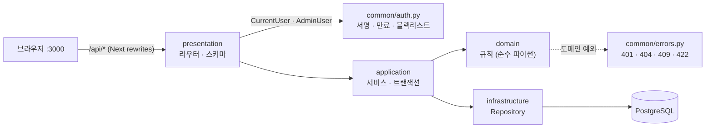

| 실패 | 상태 코드 | 예 |
| --- | --- | --- |
| 입력 형식 · 규칙 | 422 | 비밀번호 7자, 빈 제목 |
| 인증 | 401 | 로그인 안 함, 틀린 비밀번호, **로그아웃한 토큰** |
| 권한 · 남의 것 | 404 | 일반 사용자의 관리자 API, 남의 주문 |
| 규칙 충돌 | 409 | 이미 가입한 이메일, 재고 부족, 두 번 답변 |

## 7. 실행 (uv) · 환경 변수
**준비물**: Node.js 22+ · Python 3.13+ · [uv](https://docs.astral.sh/uv/) · PostgreSQL(Docker Desktop 또는 설치형)

```powershell
git clone https://github.com/KANT-2/pixel-mart-v2.git
cd pixel-mart-v2

# 1) 백엔드 (backend/)
cd backend
uv sync                                                   # 가상환경 + 의존성 (uv.lock 그대로)
if (!(Test-Path .env)) { Copy-Item .env.example .env }    # 처음 한 번만
# → 8장 DB 준비 후
uv run uvicorn src.main:app --reload --port 8000

# 2) 프론트 (새 터미널, 저장소 루트)
npm ci
npm run dev
```
- 브라우저 http://localhost:3000 · API 문서(Swagger) http://127.0.0.1:8000/api/docs (오른쪽 위 **Authorize**로 로그인)
- DB 연결 확인: http://localhost:3000/api/health/db
- 로그인: `/signup`에서 이메일 가입, 또는 개발 환경의 **개발용 로그인**(이메일만). 테스트 계정은 `*@pixelmart.test`

**환경 변수 (`backend/.env`)**: 실제 값은 저장소에 올리지 않아요 (`.env.example`에 이름만)

| 이름 | 설명 |
| --- | --- |
| `ENV` | `local`이면 개발용 로그인 · 개발자 API 켜짐 |
| `DATABASE_URL` | `postgresql+asyncpg://…` (Docker는 **5433**, 설치형은 **5432**) |
| `JWT_SECRET` | 토큰 서명 비밀값 (아무 긴 문자열) |
| `FRONTEND_URL` | CORS 허용 주소 (`http://localhost:3000`) |
| `GOOGLE_CLIENT_ID` · `GOOGLE_CLIENT_SECRET` | 구글 로그인 (비우면 구글 버튼만 꺼짐, 팀 채널로만 공유) |
| `CLOUDFLARE_ACCOUNT_ID` · `CLOUDFLARE_API_TOKEN` · `CLOUDFLARE_IMAGE_MODEL` · `AI_AVATAR_PER_HOUR` | AI 픽셀 아바타 (비우면 AI 만들기만 꺼짐) |

| 검사 명령 | 위치 |
| --- | --- |
| `uv run ruff check .` · `uv run pytest --ignore=tests/test_seed_demo.py` · `uv run alembic heads` | `backend/` |
| `npm run lint` · `npx tsc --noEmit` · `npm test` · `npm run build` | 저장소 루트 |

**CI**: `main`으로 가는 PR과 `main` push마다 GitHub Actions가 위 검사를 자동으로 돌려요 (`.github/workflows/ci.yml`, PostgreSQL 16 서비스 + `alembic upgrade head` + `seed`). `tsc`가 경로 타입(`PageProps`) 오류를 내면 `npx next typegen`을 먼저 실행해요.

### 배포할 때 (production) — #58
배포 환경에서는 `backend/.env` 대신 **배포 서비스의 환경 변수 화면**에 값을 넣어요. 실제 값은 저장소 · 이슈 · Notion 어디에도 쓰지 않아요.

| 이름 | 배포 값 | 안 지키면 |
| --- | --- | --- |
| `ENV` | `production` | 개발용 로그인(`/api/auth/dev-login`) · 개발자 API(`/api/dev/...`)가 열려 있게 돼요. production이면 둘 다 **404** |
| `JWT_SECRET` | 32자 이상 새 비밀값 | 기본값이거나 짧으면 **서버가 시작을 거부**해요 (기본값은 공개돼 있어 토큰 위조 가능) |
| `FRONTEND_URL` | 배포한 프론트 주소 (`https://…`) | CORS가 막히고 구글 콜백(`<FRONTEND_URL>/api/auth/google/callback`)이 틀어져요 |
| `DATABASE_URL` | 클라우드 PostgreSQL 주소 | 비밀번호 포함 — 배포 화면에만 |
| (프론트) `BACKEND_URL` | 배포한 백엔드 주소 | `/api/*` 전달이 안 돼요 |

- production에서는 로그인 쿠키가 `secure`(https 전용)로 바뀌어요. 로그인 화면의 개발용 로그인 칸도 production 빌드에서는 안 보여요.
- 배포 DB 준비: `uv run alembic upgrade head` → `uv run python -m scripts.seed` → `/api/health/db` 200 확인 → 관리자는 `scripts.make_admin`
- 실제 배포(어느 서비스에 · 비용)는 팀이 정한 뒤 진행해요. 확인할 장면: 배포 주소에서 로그인 → `/me` 200 → 로그아웃 → **같은 토큰 401**

## 8. DB 준비
```powershell
# Docker를 쓸 때 (저장소 루트). 설치형 PostgreSQL이면 건너뛰기
docker compose up -d db

# backend/에서
uv run alembic upgrade head                      # 테이블 만들기 · 최신 마이그레이션
uv run python -m scripts.seed                    # 상품 · 지역 · 취향 · 키보드 (재실행 안전)
uv run python -m scripts.seed_demo               # 선택: 시연용 데모 이웃
uv run python -m scripts.make_admin 이메일        # 관리자 만들기 (먼저 한 번 가입·로그인한 계정)
uv run python -m scripts.purge_blacklist         # (가끔) 이미 만료된 로그아웃 토큰 줄 정리 — 만료 전 줄은 남겨서 401 그대로
```
- pytest는 **지금 연결된 DB를 그대로** 써요. 데모 이웃을 지우는 `tests/test_seed_demo.py`는 빼고 돌리고, 테스트 뒤 `seed_demo`를 다시 실행해 주세요.
- 스키마 · ERD: [docs/backend/ERD_DAY1.md](docs/backend/ERD_DAY1.md) · [docs/backend/SCHEMA.md](docs/backend/SCHEMA.md)

## 9. 개인별 Use Case
> 각자 자기 칸을 채워요: **흐름 · 관련 파일 · API · 정상/실패 결과 · 캡처 · 인수 전후 비교**. 모두 **로그인 → 내 API 200 → 로그아웃 → 같은 토큰 401**을 보여 줘요.

### 🛡️ 주문하기 (재고 · 배송비): 양성용
- **UC 한 줄**: 로그인 사용자가 장바구니 상품을 주문하면 서버가 재고와 배송비를 검증하고, 주문·상태 기록·알림·재고 차감·장바구니 비우기를 한 트랜잭션으로 확정합니다.

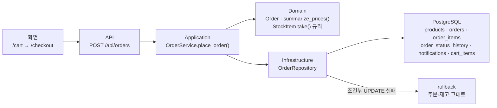

- **관련 파일**: 화면 `components/cart/` · `components/orders/CheckoutContents.tsx` · 클라이언트 `lib/cart.ts` · `lib/orders.ts` · API `backend/src/orders/presentation/` · 서비스 `backend/src/orders/application/` · 도메인 `backend/src/orders/domain/` · 저장소 `backend/src/orders/infrastructure/`
- **업무 규칙**: 상품 합계 30,000원 미만은 배송비 3,000원, 이상은 무료 배송 · 재고 차감은 `stock >= quantity` 조건부 UPDATE · 주문 생성 중 하나라도 실패하면 전체 rollback · 내 주문만 조회하며 남의 주문도 같은 404로 숨김
- **API**

  | 메서드 · 경로 | 정상 | 주요 실패 |
  | --- | --- | --- |
  | `POST /api/orders` | 주문 확정 201 | 입력 422 · 빈 장바구니/재고 부족 409 · 로그아웃 토큰 401 |
  | `GET /api/orders?status=&q=&page=&size=` | 상태 필터·상품명/주문번호 검색·페이지 목록 200 | 로그아웃 토큰 401 |
  | `GET /api/orders/{id}` | 내 주문 상세·타임라인 200 | 없거나 남의 주문 404 · 로그아웃 토큰 401 |

- **Swagger 정상 / 실패 증거**

  <details>
  <summary>주문 생성 201 — 상품 합계 29,000원 + 배송비 3,000원 = 총액 32,000원</summary>

  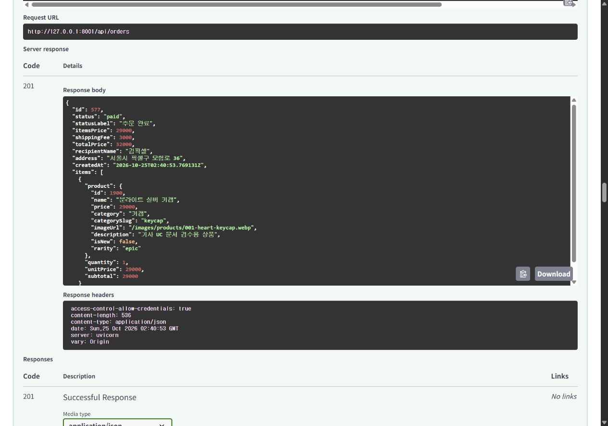
  </details>

  <details>
  <summary>받는 사람 빈칸 422</summary>

  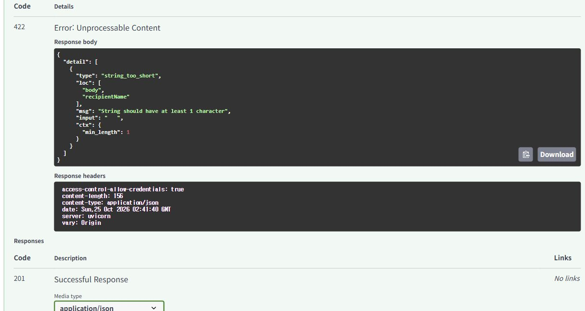
  </details>

  <details>
  <summary>없거나 다른 사용자의 주문 상세 404</summary>

  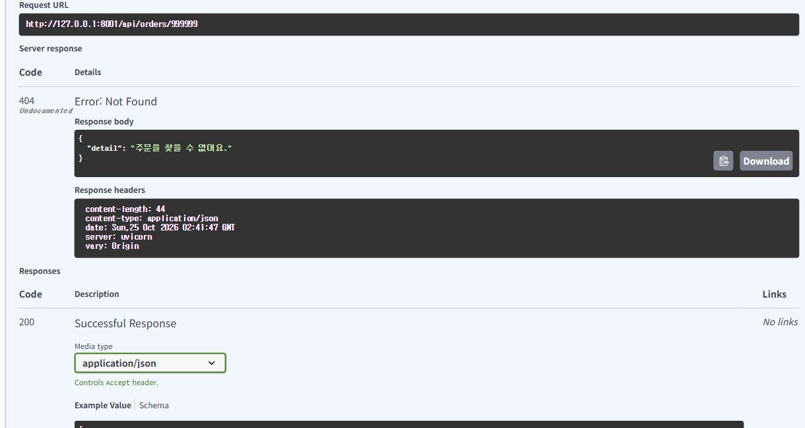
  </details>

  <details>
  <summary>빈 장바구니 주문 409</summary>

  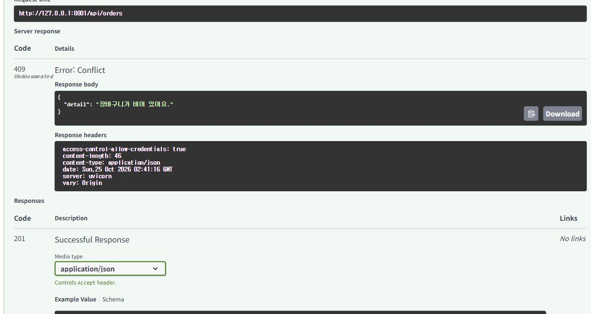
  </details>

- **로그인 → 내 API → 로그아웃 → 같은 토큰 401**

  <details>
  <summary>Bearer 로그인 뒤 <code>GET /api/auth/me</code> 200</summary>

  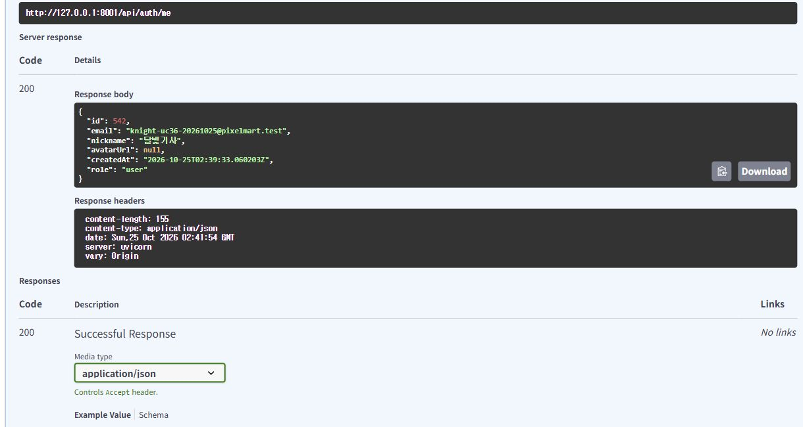
  </details>

  <details>
  <summary><code>POST /api/auth/logout</code> 200</summary>

  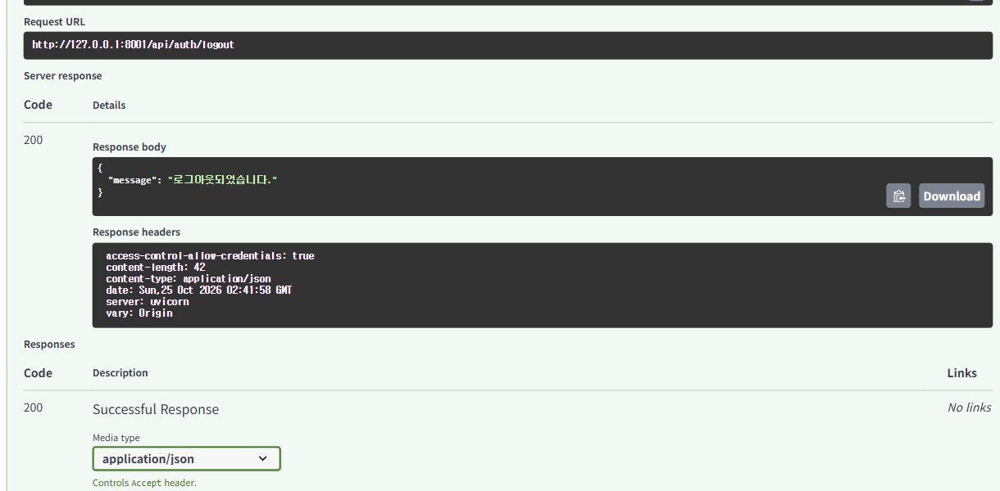
  </details>

  <details>
  <summary>로그아웃한 동일 Bearer 토큰으로 <code>GET /api/auth/me</code> 401</summary>

  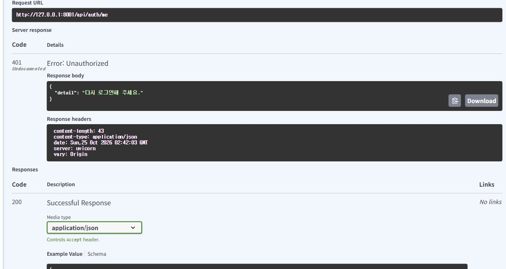
  </details>

- **인수 전후**: 재고·배송비 없이 상품 합계만 저장하던 주문 → 재고 차감·3만 원 무료 배송·검색/페이지 조회·오류 계약을 갖춘 4계층 주문으로 개선했고, 실패 시 주문과 재고가 함께 원상 유지됩니다.
- **트러블슈팅**: 공유 시드 상품 재고를 바꾸지 않도록 문서 검수 전용 상품·계정을 사용했고, 캡처에서는 Swagger의 Bearer 토큰이 보이는 Curl 영역을 제외했습니다.

### 🧭 가입 · 로그인 · 로그아웃: 채희주
- **UC 한 줄**: 이메일로 가입한 사용자가 로그인해 토큰을 받고, 로그아웃하면 그 토큰의 고유번호(`jti`)를 블랙리스트에 적어 **같은 토큰으로는 다시 들어올 수 없게** 합니다. 팀원 모두가 쓰는 로그인 확인 부품(`CurrentUser` · `AdminUser`)도 이 UC에서 만들었습니다.

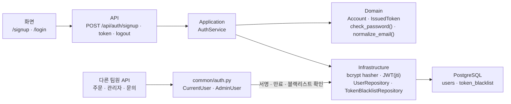

- **관련 파일**: 화면 `components/EmailSignupForm.tsx` · `components/LoginForm.tsx` · `components/AuthProvider.tsx` · `components/LoginRequiredNotice.tsx` · 클라이언트 `lib/api.ts` · API `backend/src/auth/presentation/` · 서비스 `backend/src/auth/application/` · 도메인 `backend/src/auth/domain/` · 저장소·도구 `backend/src/auth/infrastructure/` (`hasher.py` · `jwt.py` · `repositories.py`) · 공용 의존성 `backend/src/common/auth.py`
- **업무 규칙**: 비밀번호는 8자 이상 · 72바이트 이하(bcrypt 한계)이고 해시로만 저장 · 이메일은 앞뒤 공백 제거 + 소문자로 비교 · 로그인 실패는 "없는 이메일"과 "틀린 비밀번호"를 구분하지 않음 · 토큰은 Bearer 헤더를 먼저, 없으면 `pm_session` 쿠키 확인 · 로그아웃한 `jti`는 만료 시각까지 블랙리스트에 보관(같은 토큰 401, 두 번 로그아웃해도 한 줄) · 관리자가 아니면 관리자 API는 404로 숨김
- **API**

  | 메서드 · 경로 | 정상 | 주요 실패 |
  | --- | --- | --- |
  | `POST /api/auth/signup` | `{email, password, nickname}` 가입 201 | 비밀번호 8자 미만 422 · 중복 이메일/닉네임 409 |
  | `POST /api/auth/token` | OAuth2 form(`username`=이메일 · `password`) → `{access_token, token_type}` + 쿠키 200 | 틀린 이메일·비밀번호 401 "이메일 또는 비밀번호가 맞지 않아요." |
  | `GET /api/auth/me` | 내 정보 + `role` 200 | 로그아웃 토큰 401 "다시 로그인해 주세요." |
  | `POST /api/auth/logout` | `jti`를 블랙리스트에 · 쿠키 삭제 200 | 없음 (두 번 해도 200) |
  | `GET /api/admin/users?q=&role=&page=&size=` | 관리자 회원 목록(검색 · 역할 필터 · 페이지) 200 | 일반 사용자 404 · 로그아웃 토큰 401 |

- **Swagger 정상 / 실패 증거**

  <details>
  <summary>이메일 가입 201 — 응답에 비밀번호·해시 없음</summary>

  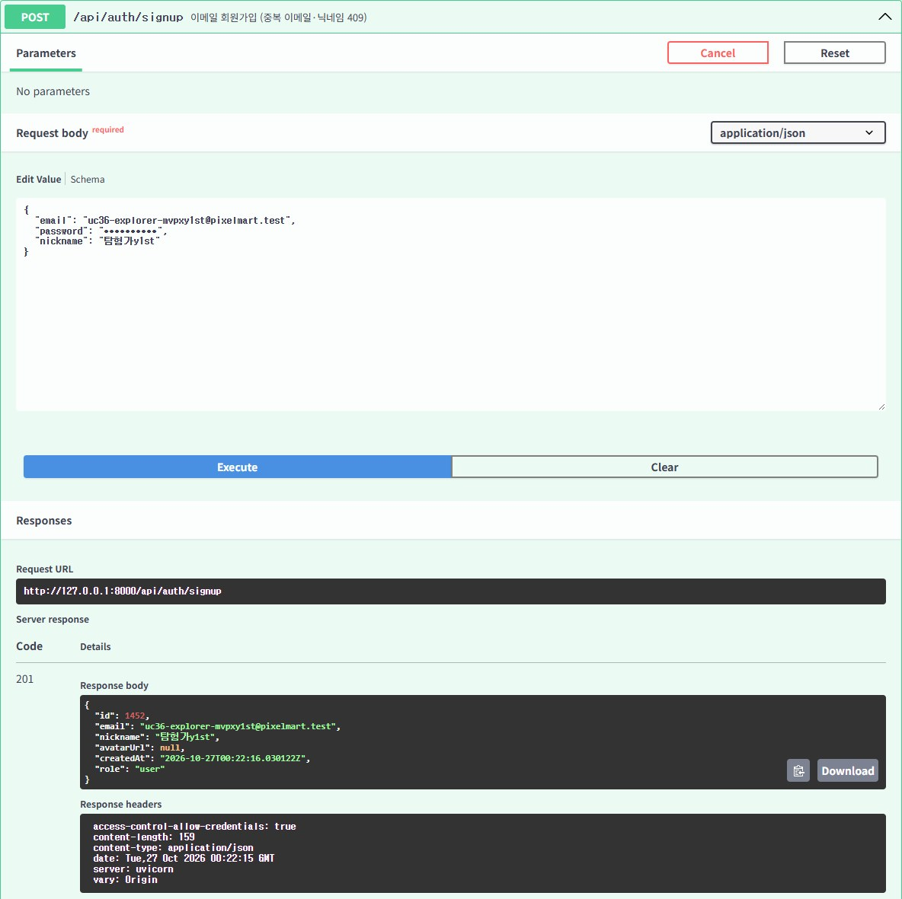
  </details>

  <details>
  <summary>비밀번호 7자 422</summary>

  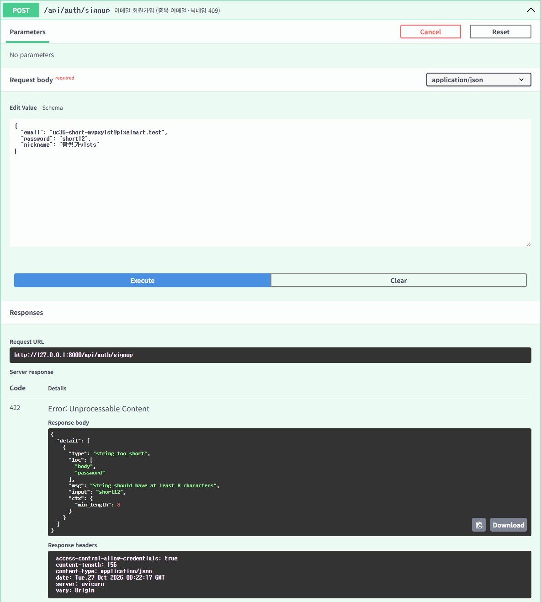
  </details>

  <details>
  <summary>이미 가입한 이메일 409</summary>

  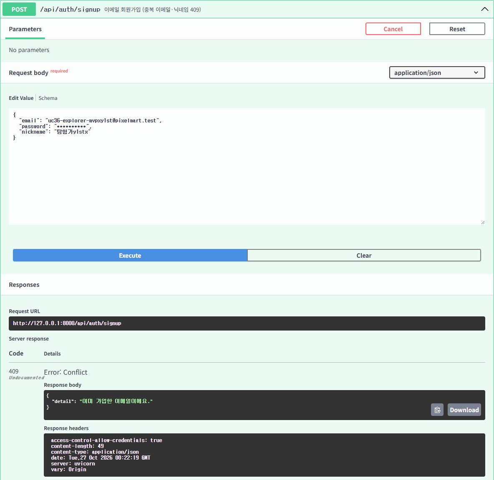
  </details>

  <details>
  <summary>틀린 비밀번호 로그인 401 — 이메일 존재 여부를 알려 주지 않음</summary>

  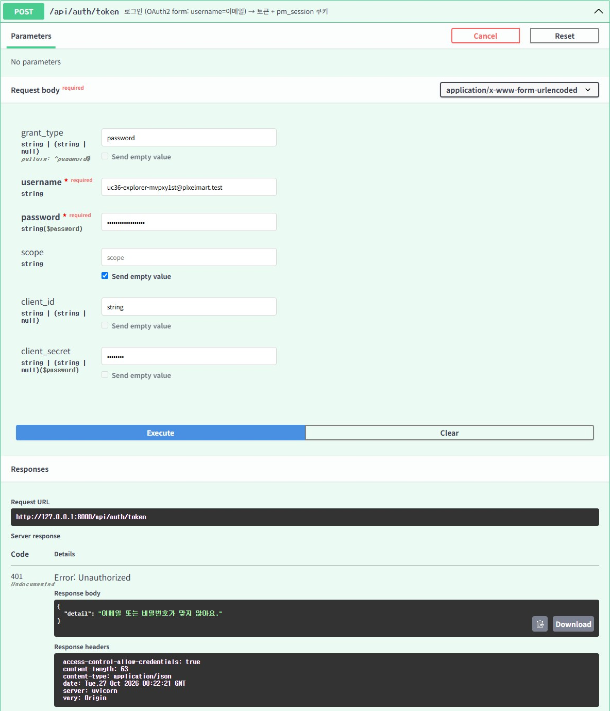
  </details>

  <details>
  <summary>OAuth2 form 로그인 200 (토큰 값은 가림)</summary>

  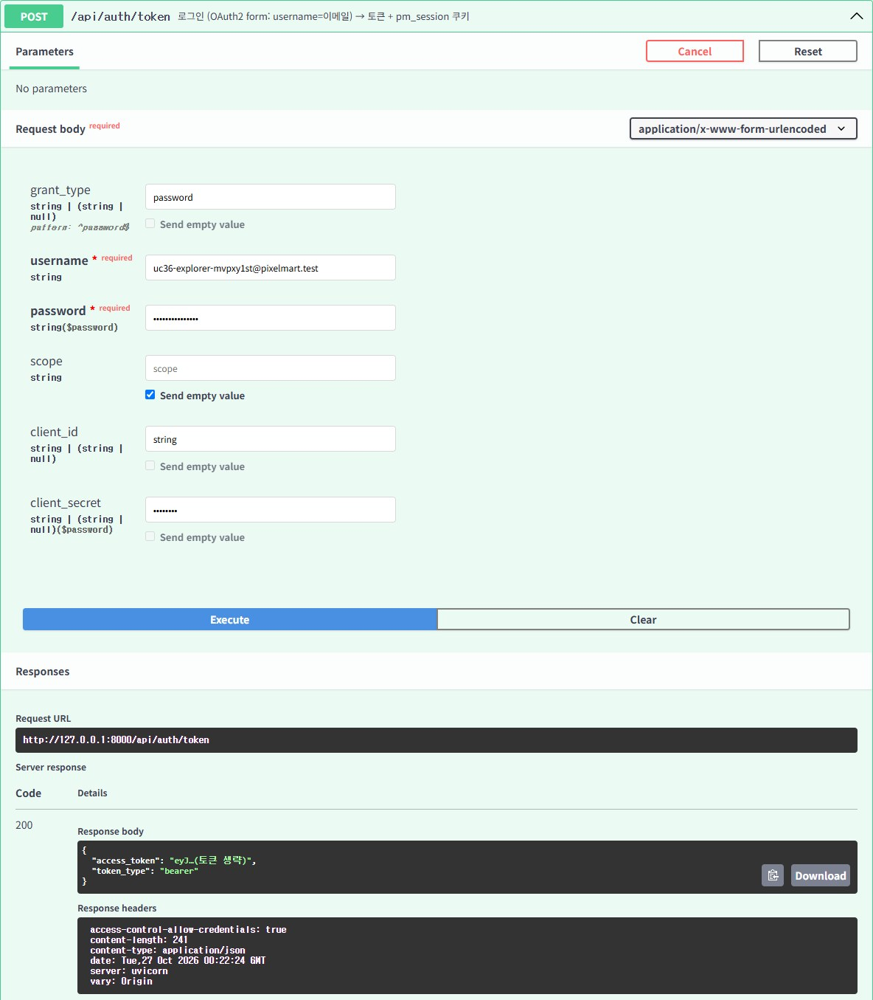
  </details>

  <details>
  <summary>일반 사용자의 관리자 회원 목록 404</summary>

  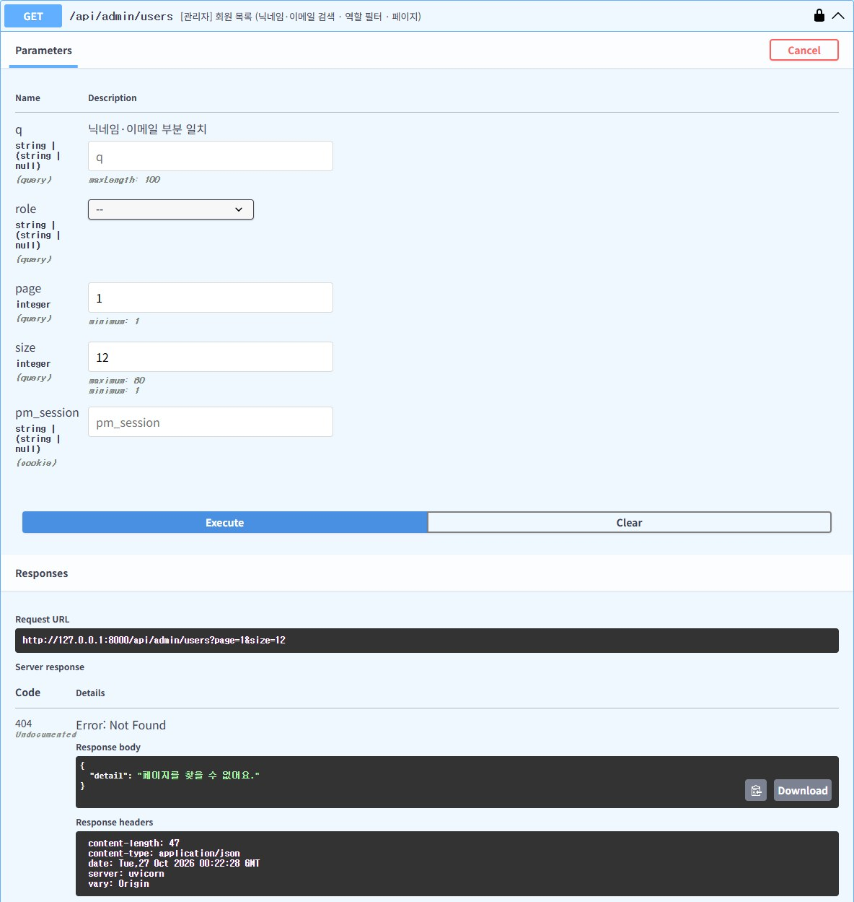
  </details>

- **로그인 → 내 API → 로그아웃 → 같은 토큰 401** (Swagger **Authorize**로 Bearer 토큰을 붙이고, 브라우저 쿠키는 지운 상태)

  <details>
  <summary><code>GET /api/auth/me</code> 200</summary>

  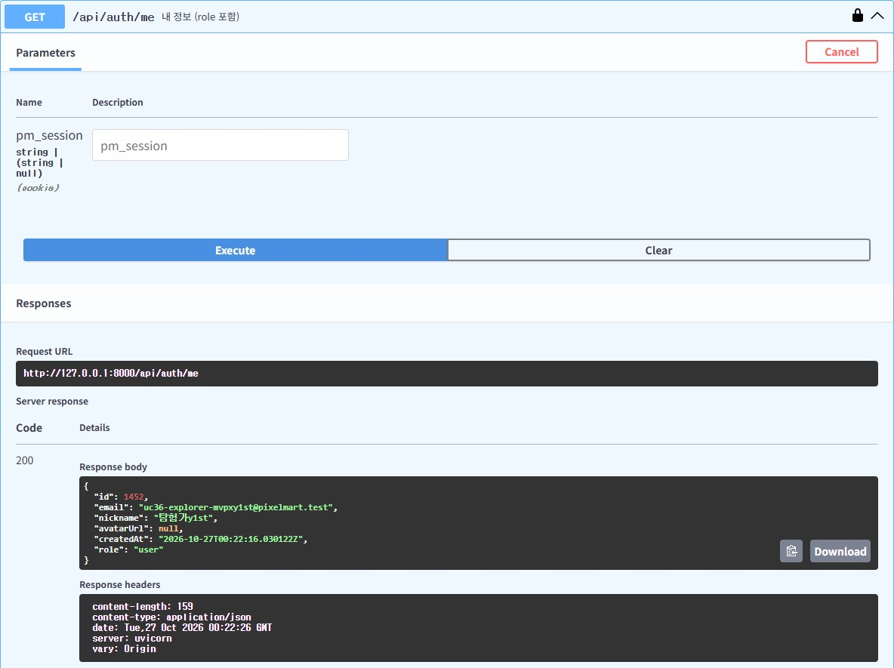
  </details>

  <details>
  <summary><code>POST /api/auth/logout</code> 200</summary>

  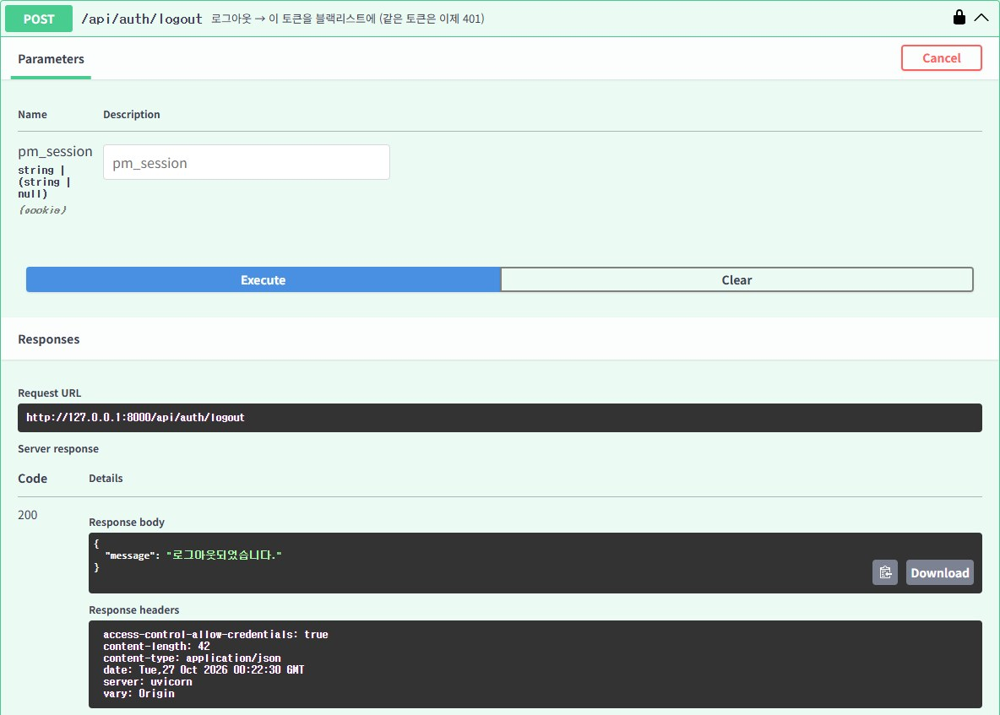
  </details>

  <details>
  <summary>로그아웃한 같은 Bearer 토큰으로 <code>GET /api/auth/me</code> 401</summary>

  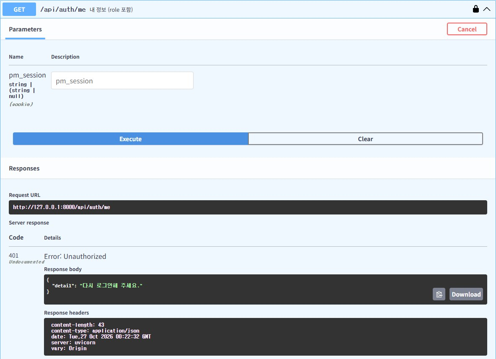
  </details>

- **테스트**: `tests/test_auth_domain.py`(규칙, DB 없음) · `tests/test_auth_service.py`(가짜 저장소로 commit/rollback, 실제 DB로 블랙리스트 중복·정리) · `tests/test_auth_api.py`(Bearer · 쿠키 · 개발용 로그인 토큰 모두 로그아웃 후 401, 관리자 API 404/200) · `tests/test_admin_users.py`
- **인수 전후**: 구글 · 개발용 로그인만 있고 로그아웃은 쿠키 삭제뿐이라 복사해 둔 토큰이 7일간 유효 → 이메일 가입(bcrypt) · OAuth2 로그인 · `jti` 블랙리스트로 **로그아웃 즉시 같은 토큰 401**. 구글 · 개발용 로그인 토큰과 기존 `app/` API도 같은 검사를 받습니다.
- **트러블슈팅**: OAuth2 form 로그인은 `python-multipart`가 있어야 동작 → `uv add`로 추가 · bcrypt 5.0이 72바이트 넘는 비밀번호에서 오류 → 요청 검사에서 72바이트 제한 · `/api/auth/signup` 경로가 기존 구글 닉네임 가입과 겹침 → 구글 쪽을 `/api/auth/google/signup`으로 이동 · 캡처는 테스트 전용 계정(`*@pixelmart.test`)으로 찍고 비밀번호·토큰 값은 가렸습니다.

### 🏹 관리자 주문 관리: 우동현
- **흐름**: `/admin/orders` → `POST /api/admin/orders/{id}/advance` → `OrderProgress.advance()`(한 칸씩) → 상태 · 기록 저장 + 구매자 알림 / 취소 요청 → `CancelRequest.approve()` → 주문 취소 + `StockItem.restore()`
- **관련 파일**: `backend/src/admin_orders/` · (화면) `app/admin/`
- **API**: (작성 예정)
- **정상 / 실패**: (작성 예정: 끝 칸에서 또 넘기기 409 · 이미 처리한 취소 409 · 일반 사용자 404 · 로그아웃 토큰 401)
- **캡처**: (작성 예정)
- **인수 전후**: 개발자 API로만 처리 → 관리자 화면 + 허용된 상태 전이만

### 🔮 상품 문의 → 관리자 답변: 김예주
- **UC 한 줄**: 로그인 사용자가 상품 상세 Q&A 탭에서 문의(비밀글 선택 가능)를 남기면, 관리자가 `/admin/questions`에서 **한 번만** 답변하고 작성자에게 알림이 갑니다.

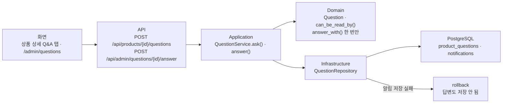

- **관련 파일**: 화면 `components/products/QuestionsPanel.tsx` · `QuestionEntries.tsx` · `QuestionDeleteButton.tsx` · `app/admin/questions/` · 클라이언트 `lib/questions.ts` · API `backend/src/questions/presentation/` · 서비스 `backend/src/questions/application/` · 도메인 `backend/src/questions/domain/` · 저장소 `backend/src/questions/infrastructure/`
- **업무 규칙**: 제목 1~100자 · 내용 1~500자 · 답변 1~500자 (앞뒤 공백 제외) · 비밀글은 작성자와 관리자만 내용을 보고, 다른 사람에게는 서버가 제목·내용·닉네임을 `null`로 가림 · 답변은 한 번만 (두 번째 409) · 답변이 달린 문의는 삭제할 수 없음 (409, 대화 기록 보존) · 남의 문의 삭제와 일반 사용자의 관리자 API는 404로 숨김 · 답변 저장과 작성자 알림은 한 트랜잭션
- **API (기존 → 이번)**

  | API | 인수 당시 (`app/routers/questions.py`) | 이번 (`src/questions/`) |
  | --- | --- | --- |
  | `GET /api/products/{id}/questions` | 목록 · 페이지 (size 기본 10) | **+ `answered` 필터** · size 기본 20 · 비밀글은 작성자·**관리자**도 봄 (#30) |
  | `POST /api/products/{id}/questions` | 쓰기 (라우터·서비스에 규칙이 섞임) | 같은 주소 · 규칙은 `Question` 도메인 · 실패 시 rollback (#30) |
  | `DELETE /api/questions/{id}` | 없음 | **새로** · 본인만 · 답변 전에만 (남 404 · 답변 후 409) (#30) |
  | `GET /api/admin/questions?answered=&q=&page=` | 없음 | **새로** · 관리자만 · 답변 여부 필터 · 상품 이름/제목 검색 · 비밀글 내용도 보임 · `productName`·`authorNickname` (#31) |
  | `POST /api/admin/questions/{id}/answer` | `POST /api/dev/questions/{id}/answer` — 로컬에서 로그인한 누구나 · 두 번 답변 400 | **관리자만**(아니면 404) · 두 번 답변 **409** · 작성자 알림 · 개발용 API 삭제 (#31) |
- **Swagger 정상 / 실패 증거**

  <details>
  <summary>문의 쓰기 201</summary>

  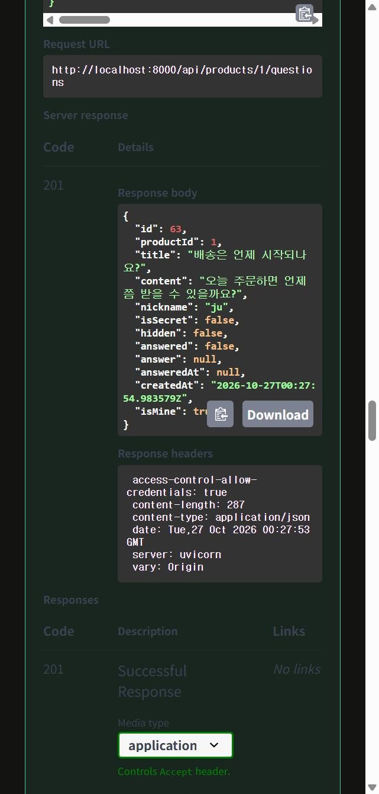
  </details>

  <details>
  <summary>빈 제목 422</summary>

  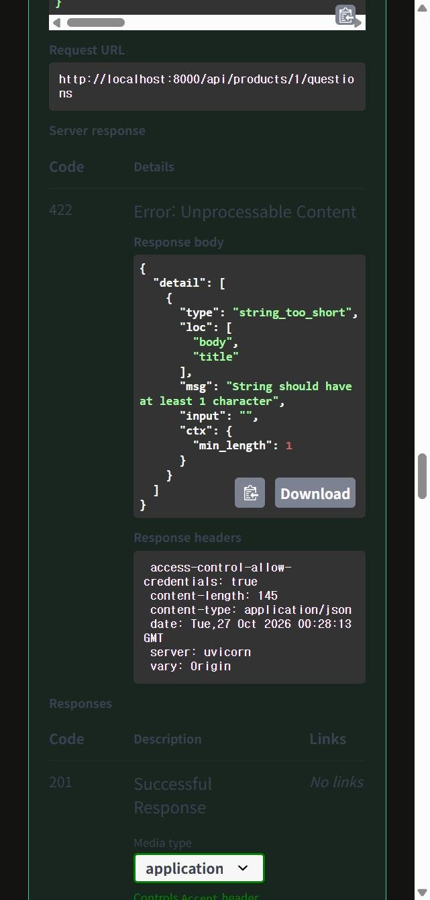
  </details>

  <details>
  <summary>없는 상품에 문의 404 — "상품을 찾을 수 없어요."</summary>

  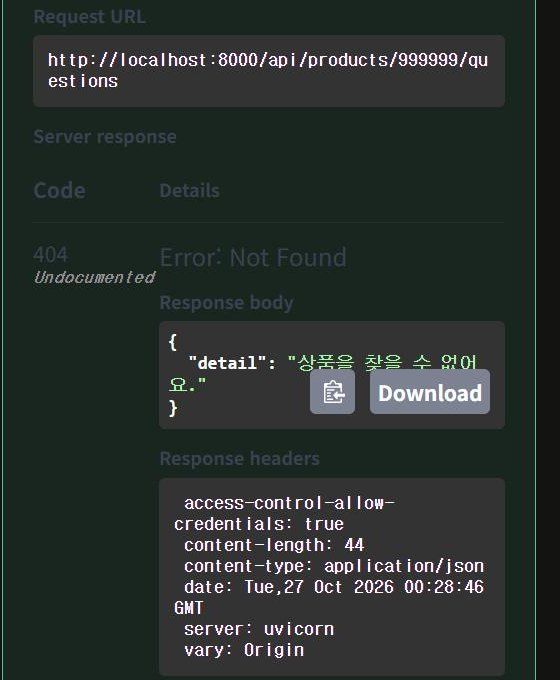
  </details>

  <details>
  <summary>같은 문의에 두 번 답변 409 — "이미 답변한 문의예요."</summary>

  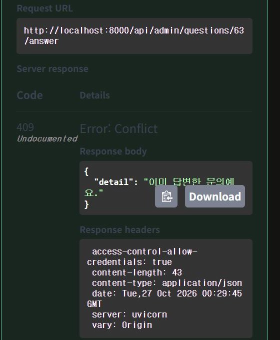
  </details>

- **로그인 → 내 API → 로그아웃 → 같은 토큰 401**

  <details>
  <summary>Bearer 로그인(관리자) 뒤 <code>GET /api/admin/questions</code> 200</summary>

  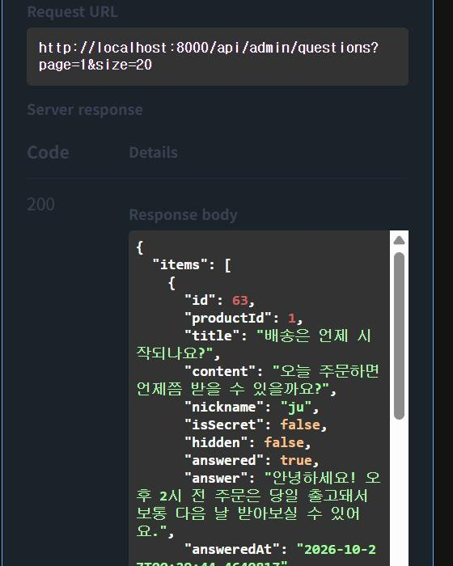
  </details>

  <details>
  <summary><code>POST /api/auth/logout</code> 200</summary>

  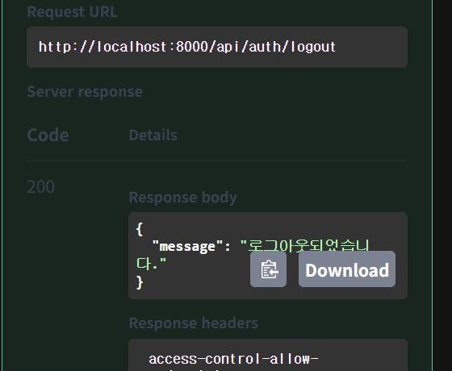
  </details>

  <details>
  <summary>로그아웃한 같은 토큰으로 <code>GET /api/admin/questions</code> 401 — "다시 로그인해 주세요."</summary>

  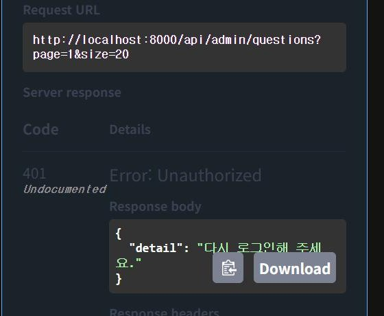
  </details>

- **화면**

  <details>
  <summary>상품 상세 Q&A — 답변 완료 · 답변 대기 · 남의 비밀글은 자물쇠 (#32)</summary>

  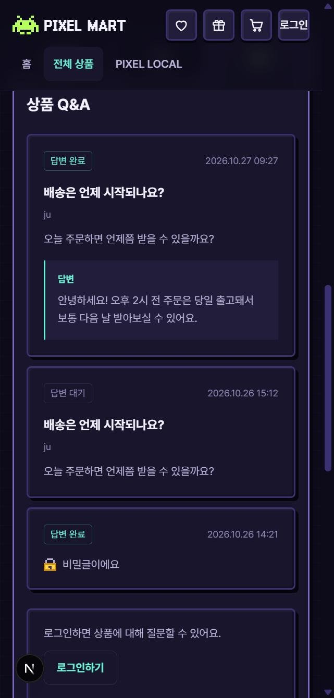
  </details>

  <details>
  <summary>관리자 문의 답변 — 등록 전 확인창 (#33)</summary>

  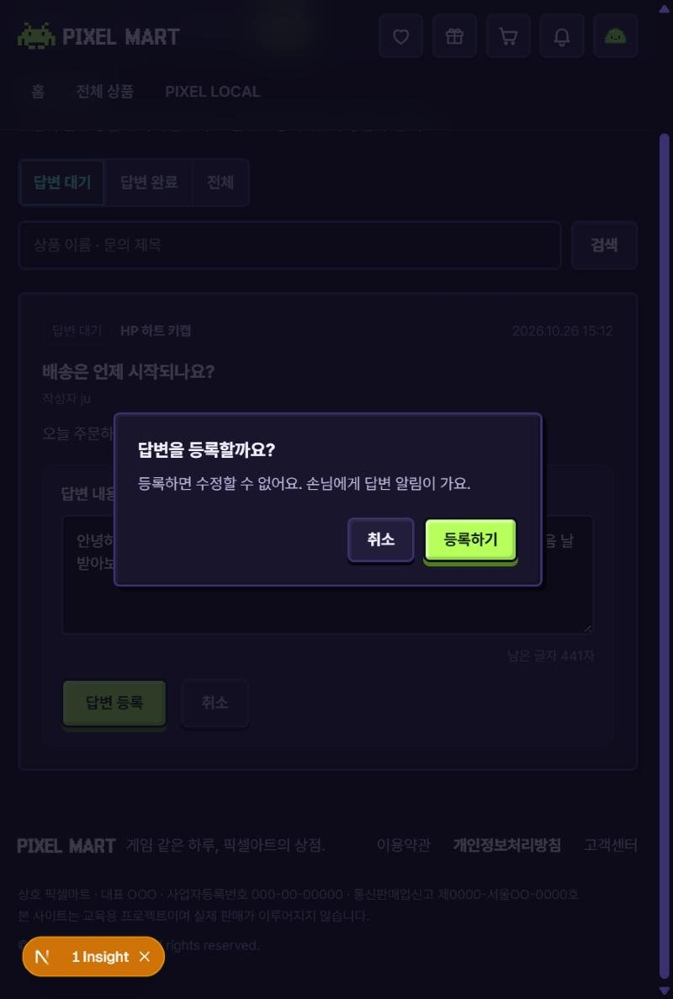
  </details>

- **인수 전후**: 새로고침하면 사라지는 메모리 데이터 → DB 저장 · 비밀글은 화면이 아니라 서버에서 가림 · 로그인한 누구나 쓰던 개발용 답변 API → 관리자만 · 관리자 답변 화면 새로 · 함께 메인 하트·코인(#34)과 상품 카테고리 개수(#35)도 하드코딩 → API 값으로 연결
- **트러블슈팅**: 동시에 `main.py`를 고친 팀원 PR과 충돌 → 두 `include_router` 줄을 모두 남겨 해결 · Windows 앱 제어가 `alembic.exe`를 막음 → `uv run python -m alembic`으로 실행 · 캡처 이미지가 `git add -A`에 섞여 커밋됨 → `git rm --cached` 후 `.git/info/exclude`에 등록 (PowerShell `echo`는 인코딩이 달라 `Set-Content -Encoding ascii` 사용) · 캡처에서는 Bearer 토큰이 보이는 Curl 영역을 제외

## 10. 미완료 · Mock 목록
| 항목 | 지금 상태 | 담당 |
| --- | --- | --- |
| 관리자 화면 | 백엔드 머지 전까지 `mocks/` 임시 데이터 (`USE_MOCK`) | 🏹 |
| 결제 | 가상 주문 (실제 결제 없음) | |
| 구글 로그인 · AI 아바타 | 키가 없으면 버튼만 꺼짐 (`.env` 값 필요) | |
| 배포 · CI | 로컬 개발 전용, CI 없음 (추가 퀘스트) | 🧭 |
| 알려진 문제 | 처음 clone한 뒤 `npx tsc --noEmit`이 `PageProps` 오류를 내면 `npx next typegen`을 먼저 (경로 타입 생성) | |

---

## 부록: 1차 결과물
### 1차 팀 (2026.10.07 ~ 10.13)
| 이름 | 역할 | 담당 |
| --- | --- | --- |
| 채희주 ([@kixxuya](https://github.com/kixxuya)) | 프론트엔드 | 화면 전체, 디자인 시스템, 메인·상품·PIXEL LOCAL UI |
| [@skshdwkdvkfl55-art](https://github.com/skshdwkdvkfl55-art) | BE-A 플랫폼·커머스 | 구글 로그인, 장바구니, 찜, 아바타, PIXEL LOCAL(덕력지도·거래) |
| [@totoriri605-oss](https://github.com/totoriri605-oss) | BE-B 주문·CS | FAQ, 가상 주문·배송, 취소, 리뷰, 상품 Q&A, 키캡 호환성 |
| [@kyrdufmal-summer](https://github.com/kyrdufmal-summer) | BE-C → 기획·정책 | PIXEL LOCAL 서비스 정의·운영 정책·개인정보 기준 정리(이슈 #151~), 현재 구현·화면 구조 문서화 |

### 기술 스택
| 구분 | 사용 기술 |
| --- | --- |
| 프론트 | Next.js 16 (App Router, Turbopack, Cache Components) · React 19 · TypeScript 5 · Tailwind CSS 4 (`@theme` 디자인 토큰) |
| 백엔드 | FastAPI · SQLAlchemy 2 (async) · asyncpg · Alembic · Pydantic v2 · PyJWT · bcrypt · Authlib(구글 OAuth) · uv |
| DB | PostgreSQL (Docker 또는 설치형) |
| 테스트 | pytest (백엔드) · `node --test` (프론트 유틸) · ESLint · ruff |
| 외부 | Cloudflare Workers AI (AI 픽셀 아바타, 사용자 동의 시에만) |
| 폰트 | Pretendard (본문) · Galmuri (픽셀 타이틀) |
| 협업 | Git · GitHub (GitHub Flow + Pull Request · 이슈·라벨) · Notion |

### 페이지 구성
| 경로 | 페이지 | 주요 내용 | 상태 |
| --- | --- | --- | --- |
| `/` | 메인 | 배너 3장(내 캐릭터 · 월드맵 · 데스크 룩북), 추천 아이템 | ✅ |
| `/products` | 전체 상품 | 검색·정렬·필터·등급, 무한 스크롤 | ✅ |
| `/products/[id]` | 상품 상세 | 이미지·정보·장바구니, 상품정보·리뷰·문의 탭, 같은 카테고리, 최근 본 아이템, 없는 id 안내 | ✅ |
| `/products/[id]/fitting` | 키캡 피팅룸 | 내 키보드에 끼워 보기, 조합 장바구니 담기 | ✅ |
| `/lookbook` | 데스크 테마 룩북 | 테마별 데스크와 상품 | ✅ |
| `/cart` · `/checkout` | 장바구니 · 주문하기 | 수량·합계, 배송지 입력, 가상 주문 | ✅ |
| `/login` · `/signup` | 로그인 · 가입 | 이메일·비밀번호 로그인/가입(2차), 구글 로그인 + 닉네임 정하기, 개발용 로그인 | ✅ |
| `/mypage` | 마이페이지 | 닉네임, 아바타, 뱃지 도감, 바로가기 | ✅ |
| `/mypage/orders` · `/[id]` | 주문 내역 · 상세 | 배송 단계·타임라인, 취소 신청, 리뷰 쓰기 | ✅ |
| `/mypage/wishlist` · `/gifts` · `/avatar` · `/quests` | 찜 · 선물함 · 픽셀 아바타 · 내 퀘스트 | 찜 목록, 받은/보낸 선물(받기·거절), AI·캔버스 아바타, 퀘스트 요약 | ✅ |
| `/local` | 덕력지도 | 시 › 구 › 생활권 지도, 취향 필터, 지역 패널, 이웃 카드 | ✅ |
| `/local/wish-map` | 위시맵 | 동네별 WISH 글, 닉네임·아이템 검색, 선물하기 | ✅ |
| `/local/trades` · `/new` · `/mine` | 거래·교환 | 게시판, 글쓰기, 내 글·교환 신청함·매칭 | ✅ |
| `/local/gift` | 이웃에게 선물하기 | 수량·메시지, 데모 결제 | ✅ |
| `/local/settings` | 내 동네·취향 설정 | 동네·취향(최대 20), 공개 설정 5종 | ✅ |
| `/help` | 고객센터 | FAQ 검색·분류 | ✅ |
| 404 · 오류 | GAME OVER 화면 | 없는 페이지·없는 상품·오류 | ✅ |

#### 사용자 흐름 (요약)
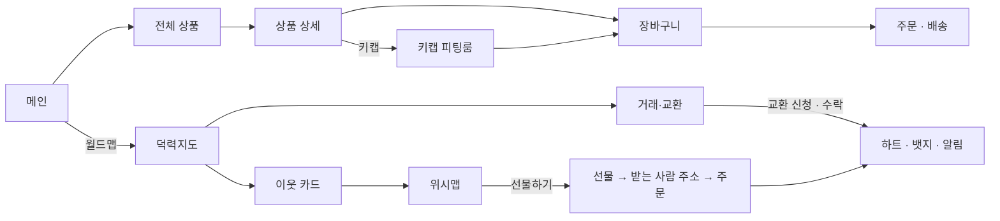
화면 구조·컴포넌트 트리·흐름 5개 상세는 **[docs/UI_STRUCTURE.md](docs/UI_STRUCTURE.md)** 에 있습니다.

### 화면 캡처 (1차)
| 메인 (데스크톱) | 메인 (모바일) |
| --- | --- |
|  |  |

| 전체 상품 (무한 스크롤) | 상품 상세 |
| --- | --- |
|  |  |

| 키캡 피팅룸 | 데스크 룩북 |
| --- | --- |
|  |  |

| PIXEL LOCAL 덕력지도 | 덕력지도 (모바일) |
| --- | --- |
|  |  |

| 거래·교환 | 위시맵 (선물하기) |
| --- | --- |
|  |  |

> 캡처는 로그인하지 않은 상태, 1280px·390px 화면 기준입니다.

### 문서
| 문서 | 내용 |
| --- | --- |
| [docs/UI_STRUCTURE.md](docs/UI_STRUCTURE.md) | 화면 구조 기획과 분할 · 컴포넌트 조립과 배치 · 사용자 흐름 |
| [docs/PIXEL_LOCAL_AS_BUILT.md](docs/PIXEL_LOCAL_AS_BUILT.md) | PIXEL LOCAL 현재 구현 (화면 문구·규칙·알려진 한계·시연 순서) |
| [docs/archive/TASTE_COMMERCE_PLAN.md](docs/archive/TASTE_COMMERCE_PLAN.md) | (보관) 10/12 기준 다음 단계 기획 (취향 세분화·하트·개인정보·레퍼런스 분석) |
| [docs/PIXEL_LOCAL_POLICY.md](docs/PIXEL_LOCAL_POLICY.md) · [docs/DUKRYEOK_MAP_POLICY.md](docs/DUKRYEOK_MAP_POLICY.md) · [docs/AVATAR_POLICY.md](docs/AVATAR_POLICY.md) | 운영 정책 |
| [docs/PRODUCT_STRATEGY.md](docs/PRODUCT_STRATEGY.md) · [docs/UX_CX_STRATEGY.md](docs/UX_CX_STRATEGY.md) | 상품·UX 전략 |
| [docs/backend/](docs/backend/README.md) | 백엔드 실행·구조·스키마·API |
| [AGENTS.md](AGENTS.md) · [docs/SETUP.md](docs/SETUP.md) · [docs/archive/](docs/archive/) | 작업 규칙 · 환경 세팅 · 보관 문서 |

### 트러블슈팅 (1차)
| 문제 | 원인 | 해결 |
| --- | --- | --- |
| 동적 상세 페이지의 `params` 처리 | `params`는 Promise이며, Cache Components 환경에서는 동적 값을 읽는 위치도 고려해야 함 | 페이지는 `params`를 자식에 전달하고, `<Suspense>` 내부의 `ProductDetail`에서 `await params`로 읽음. `generateStaticParams`와 `notFound()`로 정적 경로·없는 상품도 처리 |
| 모바일에서 로고 · 메뉴가 두 줄로 꺾임 | 헤더 가로 공간 부족 | `whitespace-nowrap`, 모바일 여백 축소 |
| ESLint가 `` 사용을 경고 | Next.js는 `next/image`를 권장 | 과제 권장에 따라 `` 유지, 사유를 단 주석으로 처리 |
