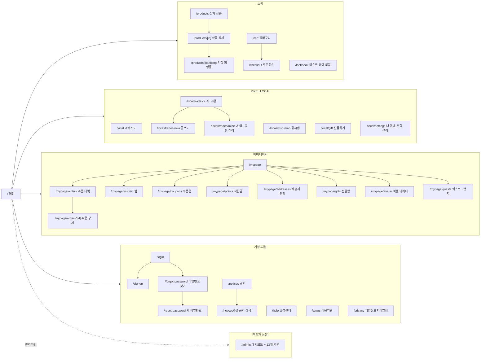
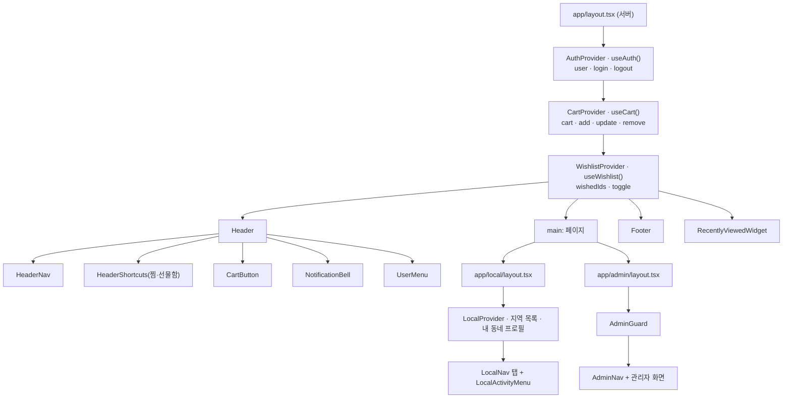
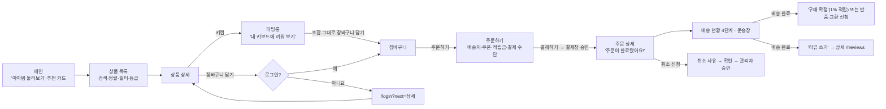
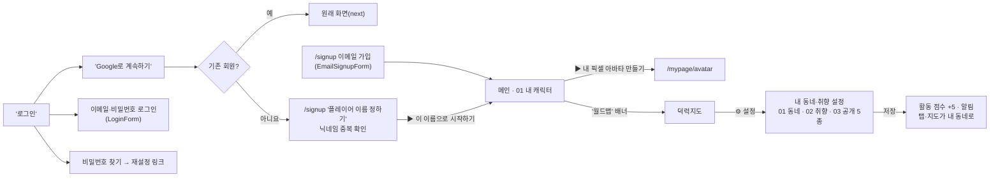
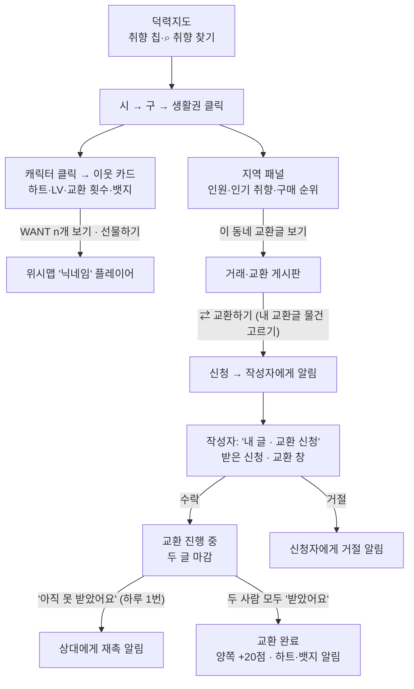
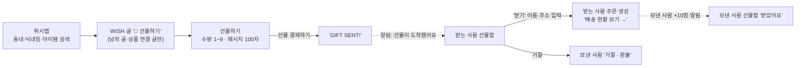
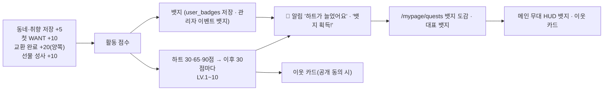

# PIXEL MART — 화면 구조 · 컴포넌트 · 사용자 흐름

> **기준: `main` (2026-10-28, PR #188까지)** · 실제 코드에서 추출했습니다. 화면 문구는 따옴표 안에 화면 그대로 적었습니다.
> 1. 화면 구조 기획과 분할 · 2. 컴포넌트 조립과 배치 · 3. 사용자 흐름(User Flow) · 4. 관리자 영역

---

## 0. 한눈에 보기

### 0-1. 사이트맵 (47개 경로 — 손님 33 · 관리자 14)



예외 화면: `app/not-found.tsx`(GAME OVER · STAGE 404), `app/products/[id]/not-found.tsx`(상품을 찾을 수 없습니다), `app/mypage/orders/[id]/not-found.tsx`, `app/notices/[id]/not-found.tsx`, `app/admin/orders/[id]/not-found.tsx`, `app/error.tsx`("ERROR!" · "화면을 불러오지 못했어요"), `app/global-error.tsx`(레이아웃까지 깨졌을 때 "잠시 문제가 생겼어요") — 모두 공통 `GameOverScreen`

### 0-2. 설계 원칙 (코드에서 일관되게 쓰인 규칙)

| 원칙 | 적용 |
| --- | --- |
| 페이지는 서버, 상호작용만 클라이언트 | `app/**/page.tsx`는 서버 컴포넌트(관리자 대시보드 `app/admin/page.tsx`만 예외). 상태·이벤트가 있는 본문만 `"use client"` |
| URL 파라미터를 읽는 클라이언트는 `<Suspense>` 안에 | `searchParams`·`useSearchParams`를 쓰는 본문은 페이지마다 스켈레톤 fallback으로 감쌈 |
| 공개 데이터는 서버, 내 데이터는 클라이언트 | 상품·카테고리·FAQ·공지는 서버에서, 장바구니·주문·찜·쿠폰·적립금·동네·선물은 클라이언트에서 |
| 실패해도 쇼핑은 동작 | 상품 API 실패 시 `data/products.ts`로 폴백 + 안내 문구 |
| 로그인 필요 동작은 돌아오기 | 비로그인 → `/login?next={현재 경로}` → 로그인 후 원래 화면 (`safeNextPath`) |
| 모든 화면에 4가지 상태 | 로딩(스켈레톤) · 빈 상태(다음 행동 버튼) · 오류(다시 시도) · 로그인 필요(`LoginRequiredNotice`) |
| 반응형 열 수 | 상품 그리드 2 → 3(md) → 4(lg), 상세·장바구니·주문은 1열 → 2열(lg) |

---

## 1. 화면 구조 기획과 분할

### 1-1. 공통 레이아웃 (`app/layout.tsx`)

```
┌──────────────────────────── Header (sticky, 반투명) ────────────────────────────┐
│ [로고 PIXEL MART]  [홈 · 전체 상품 · PIXEL LOCAL · NOTICE]   [♡ 찜][🎁 선물함][🛒 카트][🔔 알림][👤 사용자] │
└──────────────────────────────────────────────────────────────────────────────────┘
│                                   <main> 페이지                                    │
│                                              [최근 본 상품 위젯 (오른쪽 아래)]      │
└────────────── Footer: 소개 · 이용약관(/terms) · 개인정보처리방침(/privacy) · 고객센터 · 사업자 정보 ──────────────┘
```

| 영역 | 데스크톱(lg 이상) | 모바일 |
| --- | --- | --- |
| 주 메뉴 | 로고와 같은 줄 | 헤더 둘째 줄 전체 폭, 가로 스크롤 |
| 사용자 메뉴 | 아바타 + 닉네임 + ▾ | 아바타만 |
| 헤더 고정 | sticky | 휴대폰 가로(높이 500px 이하)에서는 고정 해제 |

사용자 메뉴(`components/UserMenu.tsx`): "관리자 페이지"(관리자만) · "마이페이지" · SHOP "주문 내역" · "적립금"(잔액 표시) · "쿠폰함" · PIXEL LOCAL "퀘스트 · 뱃지" · "내 글 · 교환 신청" · "고객센터" · "로그아웃"

최근 본 상품은 `RecentlyViewedWidget`(레이아웃에 1개)이 오른쪽 아래에 띄우고, 상품 상세의 `RecentlyViewedTracker`는 기록만 남깁니다.

PIXEL LOCAL 하위는 추가로 `app/local/layout.tsx`가 탭 바 **"덕력지도 · 거래·교환 · 위시맵"** 을 붙입니다(위시맵 탭은 선물 아이콘). 탭은 보고 있던 지역(`?region=`)을 유지합니다. 탭 줄 오른쪽에는 **"내 활동"** 메뉴(`components/local/LocalActivityMenu.tsx`) — "내 글·교환 신청" · "선물함" · "내 WISH 올리기" · "동네·취향 설정", 확인할 것(받은 신청·받을 선물) 개수 배지.

### 1-2. 쇼핑 화면

**메인 `/`**
```
[공지 배너 NoticeBanner — 고정 공지가 있을 때만, 헤더 아래·히어로 위]
┌ 메인 배너 캐러셀 (3장: 01 내 캐릭터 → 02 월드맵 → 03 데스크 룩북, 번호 탭 + 진행 막대 + ‹ ›) ┐
│  [왼쪽: kicker · 제목 · 설명 · 버튼 2개]        [오른쪽: 게임 무대 / 픽셀 지도 / 룩북 카드]   │
└─────────────────────────────────────────────────────────────────────────────────────┘
┌ ▶ QUEST · RECOMMENDED  추천 아이템                                   전체 보기 → ┐
│  상품 카드 4개  (2열 → 3열 md → 4열 lg)                                          │
└───────────────────────────────────────────────────────────────────────────────┘
```
배너는 md 이상 2열(텍스트 | 시각 요소), 모바일은 1열로 쌓임.

**상품 목록 `/products`**
```
[kicker · h1 "전체 상품" · "총 N개"]
[도구 막대: 검색 | 정렬 ▾ | ☰ 필터 ▾ | 등급 칩 COMMON·RARE·EPIC·UNIQUE]   ← lg 미만에서 필터 줄이 아래로 내려감
[상품 그리드 2 → 3 → 4열, 무한 스크롤 + "더 보기"]
```

**상품 상세 `/products/[id]`**
```
[breadcrumb 홈 › 전체 상품 › 카테고리]
┌ 이미지(등급 테두리·NEW·RARITY) ┬ 정보: 이름+찜 · 가격 · 설명 · ITEM STATS · [수량][장바구니 담기] [끼워 보기] [목록으로] ┐   ← md 2열 / 모바일 1열
[탭: 상품정보 | 리뷰(★ · N개, 포토 리뷰) | 문의]   (#info · #reviews · #qna) — 리뷰·문의마다 신고(ReportButton)
[같은 카테고리 상품 2 → 4열]
```

**키캡 피팅룸 `/products/[id]/fitting`**
```
┌ STEP 1 내 키보드 (모델·스위치·나머지 키 색) ┬ 내 조합 ┐   ← lg 2열 (본문 | 320px)
│ STEP 2 키보드 미리보기 (끼우기 전/후)        │ 장바구니에 담긴 키캡 │
│ 키캡 서랍 (검색·종류·색 필터, 3 → 6열)        │ 상세로 돌아가기 │
└────────────────────────────────────────┴──────────┘
```
휴대폰 세로: 회전 안내 / 휴대폰 가로: 키보드 | 키캡 서랍 분할 스크롤

**장바구니 `/cart` · 주문 `/checkout`**
```
┌ 담은 상품 목록 (썸네일·이름·단가·수량·소계·삭제) ┬ 합계 aside (sticky) [주문하기] ┐   ← lg 2열
┌ 배송지: 저장한 배송지 · 주소 검색 · 휴대폰 11자리 · 상세 주소(필수) · 배송 메모 ┬ 주문 요약 ┐
│ 할인 · 적립금: 쿠폰 선택 · 적립금 사용 · 결제 수단                              │ [결제하기] → 결제창(PaymentSheet) ┘
```
가상 결제 — 결제창에서 승인하면 주문이 만들어짐 (`components/orders/CheckoutContents.tsx`)

### 1-3. PIXEL LOCAL 화면

**덕력지도 `/local`**
```
[헤더: 덕력지도 · ⚙ 설정]
[위치: 전체 › 시 › 구]
[도구 막대: 취향 칩(전체·내 취향·⌕ 취향 찾기) | 동네 검색 | ◎ 내 위치로 보기]
┌ 픽셀 지도 (이름표·캐릭터·확대 +/−) + 범례 + 안내 ┬ 지역 패널 300px ┐   ← lg
│                                            │ 인원 · 인기 취향 TOP3 · 구매 순위 TOP10 │
│                                            │ 이웃 카드(캐릭터 클릭 시)        │
│                                            │ [이 동네 교환글][관련 상품][여기를 내 동네로] │
```
| 폭 | 지역 패널 위치 |
| --- | --- |
| lg 이상 | 지도 오른쪽 300px 고정 열 |
| sm ~ lg | 지도 아래 |
| 모바일 | 숨김 → 지역·캐릭터를 누르면 **아래에서 올라오는 시트**(최대 65% 높이, "닫기 ✕") |

모바일에서는 검색 줄("⌕ 검색")과 지도 안내("ⓘ 지도 안내 보기")를 접어 지도가 첫 화면에 보이게 함.

**위시맵 `/local/wish-map`**: 지도(선물 상자 핀) | WISH 패널 340px — 패널 모드 3가지(지역 / '닉네임' 플레이어 / '아이템' 위시), 하단 "이 동네 인기 찜"

**거래·교환 `/local/trades`**: [검색(닉네임·아이템) · 종류 ALL/HAVE/SELL] → [조건 칩·범위] → 카드 그리드 1 → 2 → 3 → 4열(카드마다 교환 신청 · 신고) + 페이지 이동

**내 글 · 교환 신청 `/local/trades/mine`**: ① 교환 신청(받은/보낸 탭) → ② 내 글(카드 + 거래 완료·숨기기·삭제) → ③ 교환 제안(나 ⇄ 이웃 교환 창). 신청함은 내 글·매칭을 못 불러와도 따로 보임

**선물하기 `/local/gift`**: [선물 창: 나 → 이웃 위시 / 수량·메시지] | CHECKOUT aside 320px

**설정 `/local/settings`**: 1열 3단계 — 01 내 동네 · 02 내 취향 · 03 활용과 공개(스위치 5개) → 저장

### 1-4. 마이페이지

| 화면 | 구조 |
| --- | --- |
| `/mypage` | 요약 카드(`MyPageSummary`: 아바타 → `/mypage/avatar` · 닉네임 바로 수정 · 배송 중/적립금/쿠폰 수) → 메뉴 2그룹(쇼핑: 주문 내역 · 찜 · 쿠폰함 · 적립금 · 배송지 관리 / 활동: 퀘스트 · 뱃지 · 선물함 · 내 글 · 교환 신청 · 동네·취향·공개 설정) → 계정(비밀번호 변경 · 탈퇴). 비로그인은 `LoginRequiredNotice` |
| `/mypage/orders/[id]` | 배송 현황(4단계) + 타임라인 + 운송장(`TrackingInfo`) + 주문 아이템(배송 완료 시 "리뷰 쓰기") + 취소 신청 + 배송 완료 뒤 구매 확정·반품·교환(`AfterDelivery`) \| 배송지 aside |
| `/mypage/coupons` · `/mypage/points` · `/mypage/addresses` | 쿠폰 목록·코드 등록 / 적립·사용 기록 / 기본 배송지·자주 쓰는 주소 |
| `/mypage/avatar` | 탭(AI로 만들기 / 픽셀 캔버스) \| 지금 내 아바타 aside |
| `/mypage/gifts` | 받은/보낸 탭 → 선물 행(받기: 이름·주소 입력 / 거절) |
| `/mypage/quests` | `TutorialQuestList`(튜토리얼 퀘스트) → `QuestActivity`(받을 선물 · 이어진 매칭 · 진행 중 거래) → `BadgeBook`(뱃지 도감, 대표 뱃지 고르기) |

---

## 2. 컴포넌트 조립과 배치

### 2-1. 전역 조립 (Provider 구조)



- 장바구니·찜은 로그인 사용자가 바뀌면 저장소를 새로 만들어, 다른 계정 데이터가 섞이지 않게 함
- PIXEL LOCAL 전용 상태(`LocalProvider`)는 `/local` 하위에만 둬서 쇼핑 화면에 불필요한 요청이 없음

### 2-2. 페이지별 컴포넌트 트리 (대표)

**상품 상세**
```
page (서버) ─ Suspense ─ ProductDetail (서버, async)
  ├ ProductFallbackNotice
  ├ WishButton (클라)
  ├ AddToCartButton (클라) ─ QuantityInput
  ├ ProductDetailTabs (클라) ─ 상품정보(서버 children) · ReviewsPanel(ReviewForm ─ ReviewPhotoPicker) · QuestionsPanel ─ ReportButton · FeedbackLogin
  ├ ProductCard ×4 (같은 카테고리)
  └ RecentlyViewedTracker (클라, 기록만)
```

**주문서 · 주문 상세**
```
CheckoutContents (클라) ─ ShippingFields ─ AddressSearch │ 쿠폰·적립금 │ CartPriceSummary │ PaymentSheet
OrderDetail (클라) ─ OrderProgress · TrackingInfo · CancelRequestForm · AfterDelivery(구매 확정 · 반품·교환)
```

**덕력지도**
```
page (서버) ─ LocalPageHeader ─ Suspense ─ FandomMapScreen (클라)
  ├ InterestFilter ─ 취향 찾기 팝오버
  ├ SearchToggle · MapNotes (MobileToggles)
  ├ RegionSearch
  ├ PixelMap (지도·확대 툴바)
  └ PlacePanel ─ NeighborCard ─ MyProgress │ 인기 취향 TOP3 │ BuyerRanking
     또는 PlaceGuide (지역 선택 전)
```

**내 글 · 교환 신청**
```
page (서버) ─ Suspense ─ MyTrades (클라)
  ├ TradeRequestInbox (받은/보낸 신청 → 교환 창 TradeExchange에서 수락·거절·취소·받았어요·"아직 못 받았어요")
  ├ TradeCard + TradeStatusButtons ×N (거래 완료 · 숨기기 · 삭제)
  └ SentRequestsProvider ─ TradeWindow ─ TraderPanel ×2 · TradeCard · TradeRequestButton
```

**메인**
```
page (서버)
  ├ NoticeBanner (고정 공지)
  ├ HomeCarousel (클라)
  │   ├ 01 내 캐릭터: HeroStage ─ HeroHud(hudNumbers) · HeroBadge(대표 뱃지) · HeroCharacter · HeroQuest · SpriteLayer
  │   ├ 02 월드맵: WorldMapTeaser ─ PixelMap   ← 덕력지도와 같은 컴포넌트
  │   └ 03 데스크 룩북: ThemePicker · 추천 상품 3 · 동네 인기 찜
  └ Suspense ─ RecommendedProducts ─ ProductCard ×4
```

### 2-3. 재사용 컴포넌트

| 컴포넌트 | 쓰는 화면 | 역할 |
| --- | --- | --- |
| `ProductCard` (+ `WishButton`) | 메인 · 상품 목록 · 상세(관련 상품) · 찜 · 룩북 | 상품 카드 하나로 5개 화면 통일 |
| `ProductSkeleton` · `ProductFallbackNotice` · `EmptyProducts` | 메인 · 목록 · 상세 · 룩북 | 상품 화면 공통 상태 |
| `QuantityInput` | 상세 · 장바구니 | 수량 1~99 |
| `Pagination` | 주문 내역 · 찜 · 거래 게시판 | 페이지 이동 |
| `GameOverScreen` | 404 · 상품 없음 · 오류 · 전역 오류 | 게임 콘셉트 예외 화면 |
| `LoginRequiredNotice` | 마이페이지 등 로그인 필요 화면 | 로그인 안내 + `next` 복귀 |
| `NicknameField` | 로그인 · 가입 · 마이페이지 | 실시간 중복 확인 + 추천 |
| `ShippingFields` (+ `AddressSearch`) | 주문서 · 배송지 관리 | 받는 사람 · 연락처 · 주소 검색 · 상세 주소 |
| `ReportButton` | 리뷰 · 상품 문의 · 거래 게시판 | 신고 → 관리자 신고함 |
| `PixelAvatar` | 사용자 메뉴 · 메인 무대 · 아바타 · 뱃지 · 지도 | 픽셀 이미지 표시 |
| `PixelMap` | 덕력지도 · 위시맵 · 메인 월드맵 | 지도 하나로 3곳 |
| `HomeCarousel` | 메인 | 배너 캐러셀 (`questOnly` 옵션은 남아 있지만 지금 쓰는 곳 없음) |
| `TradeCard` · `TradeRequestButton` | 거래 게시판 · 내 글 · 교환 신청 | 거래 카드·교환 신청 |
| `TraderPanel` | 내 글 · 교환 신청(교환 창) · 선물하기 | "나 ⇄ 이웃" 게임 거래 창 |
| `InterestPicker` | 설정(최대 20) · 글쓰기(1개) | 취향 고르기 |
| `LocalSkeleton` · `LocalError` | PIXEL LOCAL 전 화면 · 선물함 · 뱃지 | 공통 상태 |
| `useLocalResource` | 지도·거래·선물함·뱃지·캐러셀 | 데이터 불러오기 훅 |

### 2-4. 서버/클라이언트 경계

| 서버에서 | 클라이언트에서 |
| --- | --- |
| 페이지 셸, 제목, 상품 목록 첫 페이지, 상품 상세, 카테고리, FAQ, 공지, 룩북 상품 | 로그인 상태, 장바구니, 찜, 주문, 쿠폰·적립금·배송지, 리뷰 작성, 지도, 거래, 선물, 알림, 아바타 편집, 무한 스크롤, 관리자 화면 데이터 |

---

## 3. 사용자 흐름 (User Flow)

### 3-1. 쇼핑: 탐색 → 구매 → 배송 → 리뷰



### 3-2. 가입 → 동네·취향 설정



비밀번호 찾기·재설정(`components/PasswordResetForms.tsx`)은 메일을 보내지 않습니다 — 서버가 재설정 링크를 돌려주면(로컬) 화면에 "재설정 링크 열기"로 바로 보여 줍니다.

### 3-3. 발견 → 연결: 덕력지도 → 이웃 카드 → 교환 신청



### 3-4. 선물: 위시맵 → 선물 → 받기 → 주문



### 3-5. 신뢰: 활동 → 점수 → 하트·뱃지 → 알림



### 3-6. 화면 간 이동 표 (주요 버튼)

| 출발 | 버튼 (화면 문구) | 도착 |
| --- | --- | --- |
| 헤더 | "홈" · "전체 상품" · "PIXEL LOCAL" · "NOTICE" | `/` · `/products` · `/local` · `/notices` |
| 헤더 | ♡ · 🎁 · 🛒 | `/mypage/wishlist` · `/mypage/gifts` · `/cart` |
| 사용자 메뉴 | "관리자 페이지" · "마이페이지" · "주문 내역" · "적립금" · "쿠폰함" | `/admin` · `/mypage` · `/mypage/orders` · `/mypage/points` · `/mypage/coupons` |
| 사용자 메뉴 | "퀘스트 · 뱃지" · "내 글 · 교환 신청" · "고객센터" | `/mypage/quests` · `/local/trades/mine#trade-requests` · `/help` |
| PIXEL LOCAL "내 활동" | "내 글·교환 신청" · "선물함" · "내 WISH 올리기" · "동네·취향 설정" | `/local/trades/mine#trade-requests` · `/mypage/gifts` · `/local/trades/new?kind=want` · `/local/settings` |
| 메인 공지 배너 | 공지 제목 | `/notices/[id]` |
| 메인 01 | "▶ 내 픽셀 아바타 만들기" / "▶ 오늘의 장비 고르기" · HUD 뱃지 · 퀘스트 카드 | `/mypage/avatar` / `/products` · `/mypage/quests` |
| 메인 02 | "월드맵 열기" · "동네 교환글" · 지도 지역 | `/local` · `/local/trades` · `/local?region=` |
| 메인 03 | "{테마} 테마 상품 보기 →" | `/lookbook?theme=` |
| 상품 상세 | "장바구니 담기" → "담았어요 · 장바구니 보기" | `/cart` |
| 상품 상세 | "내 키보드에 끼워 보기" (키캡만) | `/products/[id]/fitting` |
| 장바구니 | "주문하기" | `/checkout` |
| 주문하기 | "결제하기" → 결제창 승인 | `/mypage/orders/[id]?placed=1` |
| 주문 상세 | "리뷰 쓰기" · "구매 확정" · 반품·교환 (배송 완료) | `/products/[id]#reviews` · 같은 화면 |
| 로그인 | 비밀번호 찾기 | `/forgot-password` → `/reset-password?token=` |
| 덕력지도 패널 | "이 동네 교환글 보기" · "여기를 내 동네로" | `/local/trades?region=` · `/local/settings?region=#region` |
| 이웃 카드 | "WANT n개 보기 · 선물하기" | `/local/wish-map?nickname=` |
| 위시맵 | "🎁 선물하기" · "내 WISH 올리기" | `/local/gift?post=` · `/local/trades/new?kind=want` |
| 거래 게시판 | "⇄ 교환 신청" · "글쓰기" · "내 글·교환 신청" | 신청 API · `/local/trades/new` · `/local/trades/mine` |
| 선물 완료 | "보낸 선물 보기" | `/mypage/gifts?box=sent` |
| 알림 | 교환 · 선물 · 주문 · 점수·하트 · 뱃지 | 내 글 · 교환 신청 · 선물함 · 주문 상세 · `/mypage/quests` · `/mypage/quests`(뱃지 도감) |
| 푸터 | "이용약관" · "개인정보처리방침" · "고객센터" | `/terms` · `/privacy` · `/help` |
| 404 | "▶ 홈으로 CONTINUE" · "상품 둘러보기" | `/` · `/products` |

---

## 4. 관리자 영역

| 항목 | 내용 |
| --- | --- |
| 레이아웃 | `app/admin/layout.tsx` — `AdminGuard`로 감싼 뒤 `AdminNav` + `<main>`. 탭 제목 "관리자 \| PIXEL MART", 검색엔진 노출 안 함(`robots` noindex) |
| 가드 | `components/admin/AdminGuard.tsx` — 로딩(스켈레톤) / 비로그인("관리자만 들어올 수 있어요" → `/login?next=/admin`) / 관리자 아님("권한이 없어요" → 홈) / `user.role === "admin"`만 화면 표시. 관리자 API도 관리자가 아니면 404 |
| 메뉴 | `components/admin/AdminNav.tsx` — md 이상 왼쪽 세로 사이드바(묶음 제목), 모바일은 위쪽 가로 스크롤 한 줄. 주문·취소 요청·반품·교환에 대기 건수 배지 |
| 진입 | 사용자 메뉴 "관리자 페이지"(관리자만 보임) |
| 데이터 | 전부 클라이언트에서 `lib/admin*.ts` 등으로 (상품 화면의 분류만 서버에서 공개 카테고리를 받아 폼에 사용) |

메뉴 묶음: **대시보드** / **주문 처리**(주문 · 취소 요청 · 반품·교환) / **고객 응대**(상품 문의 · 리뷰 · FAQ · 공지) / **커뮤니티 관리**(신고 · 거래글 · 사용자 · 뱃지) / **상품**(상품·재고)

| 경로 | 화면 |
| --- | --- |
| `/admin` | 대시보드 — 숫자 카드(오늘 들어온 주문 · 배송 준비중 · 취소 요청 대기 · 반품·교환 대기 · 미답변 문의, 누르면 해당 목록) + 주문 상태 차트(`OrderStatusChart`) + 재고 부족(`LowStockList`) |
| `/admin/orders` | 주문 목록 — 상태 필터 · 검색 · CSV 내보내기 |
| `/admin/orders/[id]` | 주문 상세 — 다음 단계로 넘기기 · 운송장 입력 (없는 번호는 `not-found.tsx`) |
| `/admin/cancels` | 취소 요청 — 승인 · 거절 |
| `/admin/returns` | 반품·교환 신청 — 승인 · 거절 |
| `/admin/questions` | 상품 문의 — 답변 작성·삭제, 숨김, 문의 삭제 |
| `/admin/reviews` | 리뷰 — 상태·별점·포토·검색 필터, 숨기기·다시 보이기 |
| `/admin/faqs` | FAQ 등록·수정·삭제 (`FaqForm`) |
| `/admin/notices` | 공지 등록·수정, 중요 공지 상단 고정 (`NoticeForm`) |
| `/admin/reports` | 신고함 — 상태 탭 · 종류 필터, 처리 |
| `/admin/trades` | 거래글 — 상태·종류·검색, 숨기기 (작성자에게 알림) |
| `/admin/users` | 사용자 — 상태·역할·검색, 정지·해제 · 아바타 초기화 |
| `/admin/badges` | 뱃지 — 이벤트 뱃지 만들기·고치기·주기·회수, 자동 뱃지는 받은 사람 보기 |
| `/admin/products` | 상품·재고 — 등록·수정(`ProductForm`), 노출/숨김 탭, 재고 상태·입고 |

---

## 5. 확인된 개선 포인트 (코드 기준 사실)

| 항목 | 내용 |
| --- | --- |
| 미노출 코드 | 메인 캐러셀 '토너먼트 예고' 장(`HomeCarousel`의 `labels`에 남음), 안 쓰는 `questOnly` 옵션, `app/page.tsx`의 월드맵 섹션 주석 |
| 마크업 | `/lookbook`이 레이아웃 `<main>` 안에 `<main>`을 다시 씀 |
| 덕력지도 안내 카드 | "관심 있는 상품"이 지역과 무관한 상품 검색으로 이동 |

### 해결됨

| 항목 | 해결 | 파일 |
| --- | --- | --- |
| 메인 HUD "HP"·"× 003" 고정 문구 | 로그인하면 내 하트·적립금 실제 값 (비로그인만 시안 숫자) | `components/hero/hudNumbers.ts` · `components/hero/HeroHud.tsx` |
| 퀘스트 카드 "첫 구매 시 1,000P" 고정 | 로그인하면 뱃지 도감 기준 지금 퀘스트·진행도, 비로그인만 "로그인하고 첫 구매 시 1,000P" | `components/hero/HeroQuest.tsx` |
| 푸터 "이용약관"·"개인정보처리방침"이 링크 아님 | `/terms` · `/privacy` 링크 | `components/Footer.tsx` |
| `/lookbook`·`/mypage/quests` 탭 제목 없음 | `metadata` 추가 | `app/lookbook/page.tsx` · `app/mypage/quests/page.tsx` |
| 마이페이지 비로그인 시 안내 없음 | `LoginRequiredNotice` 표시 | `components/profile/MyPageSummary.tsx` |
| 상품 목록 카테고리 개수를 정적 데이터로 셈 (TODO #16) | 서버 상품 수로 셈 | `lib/categoryCounts.ts` · `app/products/page.tsx` |
