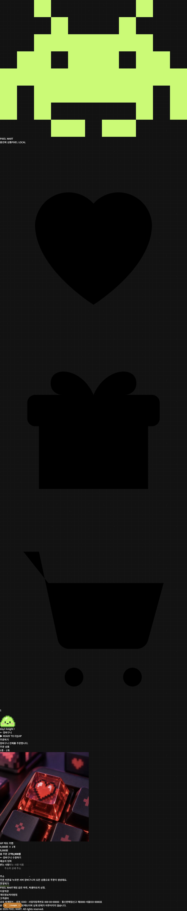
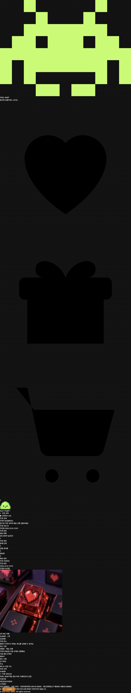

# 기사 인수 상태 확인 — Issue #1

기준 커밋 `38720a6`을 별도 작업 폴더에서 실행한 재현 기록입니다(2026-10-24). 다른 세 팀원의 확인 완료를 대신하지 않습니다.

## 실행 환경

- 소스: `C:\dev\pixel-mart-v2-baseline-day1`, detached HEAD `38720a6`.
- 프론트: `http://127.0.0.1:13001`, 백엔드: `http://127.0.0.1:18001`.
- DB: `pixelmart_issue1_baseline_test`, 포트 5434. 기존 개발 DB와 분리.
- 인수 소스는 그대로 사용하되 현재 설치된 의존성을 재사용했습니다. Python 3.14·Next.js 16.4.0, 프론트는 폴더 연결 없이 NODE_PATH와 webpack 모드로 실행했습니다. 원래 배포 환경을 완전히 복제한 결과는 아닙니다.
- `GET /api/health`: 백엔드 직접·Next 프록시 모두 200.

## 확인한 흐름

개발용 테스트 이메일 로그인 → 상품 #1 HP 하트 키캡 장바구니 담기 → 주문서 → 가상 주문 완료.

| 경계 | 확인 결과 |
|---|---|
| 화면 → API | 상품 1개·9,900원 표시 후 주문 완료 #1 표시 |
| API → DB | orders: id=1, status=paid, total_price=9900 |
| 품목 저장 | order_items: quantity=1, unit_price=9900 |
| 장바구니 처리 | 해당 테스트 계정 cart_items 0건 |
| 격리 확인 | 임시 DB 테스트 계정 1건, 개발 DB 동명 계정 0건 |

## 데이터 출처와 개선 전 상태

| 대상 | 출처 | 확인한 소스 |
|---|---|---|
| 상품 | PostgreSQL/API. API 실패 시 정적 상품 폴백 가능 | app/products, lib/api.ts, backend/app/routers/products.py |
| 장바구니 | 계정별 DB/API, 화면 메모리는 요청 중 표시용 | lib/cart.ts → /api/cart → cart_items |
| 주문·품목 | 계정별 DB/API | lib/orders.ts → /api/orders → app/services/orders.py → orders·order_items |
| 최근 본 상품 등 | 일부 브라우저 저장소 기능은 별도 존재 | 주문 데이터의 원본과 구분 |

기존 주문 총액은 품목 가격 합계만 계산했습니다. 실제 information_schema에서도 products.stock·orders.shipping_fee가 없음을 확인했습니다. 재고 차감·배송비 계산·JWT jti 블랙리스트는 이번 개선 범위이며, 이미 있던 가상 주문·배송 타임라인 자체를 신규 구현으로 주장하지 않습니다.

## 캡처

## 문제와 해결

1. 최초 프론트 실행 준비 명령이 자동 승인 검토에서 거절됐습니다(구체적 사유 미제공). 폴더 연결 없이 NODE_PATH로 기존 의존성을 재사용하고 전경 실행으로 확인했습니다.
2. 처음 선택한 8001 포트에 기존 개발 서버가 실행 중이었습니다. 초기 로그인·담기가 기존 개발 DB에 확인용 계정(id=179)과 장바구니를 생성했습니다. 주문 0건·생성 시각·전용 이메일을 확인한 뒤 해당 신규 계정과 장바구니만 제거했습니다. 기존 사용자·상품·시드는 보존했습니다. 이때의 캡처는 폐기했습니다.
3. 빈 포트 18001/13001로 변경하고, 새 로그인 후 임시 DB 계정 1건·개발 DB 동명 계정 0건을 대조한 다음 위 주문 흐름을 다시 검증했습니다.
4. 인수 소스에서 Python 문자열 escape SyntaxWarning과 기존 Authlib 경고가 보였습니다. 이번 확인에서 관련 파일을 수정하지 않았습니다.
5. Next.js 기존 보안 취약점 알림으로 최초 실행 중단 후 재시도는 성공했습니다. 경고는 남아 있으며 별도 보안 업데이트가 필요합니다.

[팀 Notion ERD·작업일지](https://app.notion.com/p/teamsparta/1-ERD-4032dc3ef514800d8b72c2929c332a9b)
