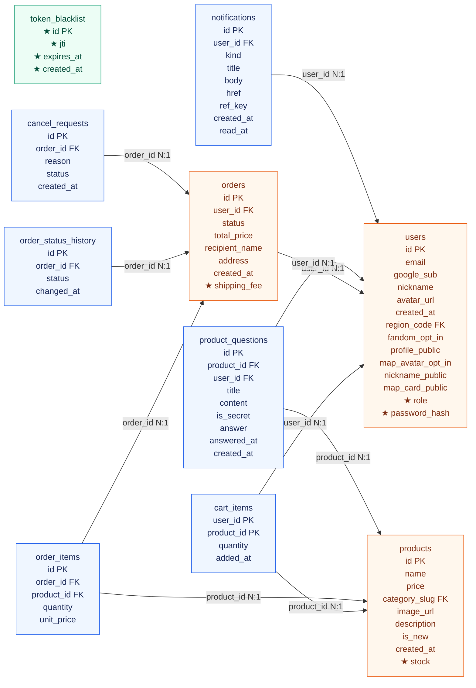

# 4개 Use Case ERD — 마이그레이션 ①
#6 · 기준: main e5ee85c + #5 PR #45의 revision d6cb42e32a1b. #5는 아직 병합 대기이므로 main 적용 완료를 뜻하지 않습니다.

파랑: 기존 테이블 · 주황: 컬럼 추가 테이블 · 초록: 새 테이블. ★는 이번 추가 컬럼입니다. 관계 화살표는 FK에서 참조 대상으로 향하며 N:1입니다. 범위 밖 참조(categories·regions)는 그림에서 생략하고 아래 컬럼 표에 기록합니다.

token_blacklist는 user_id FK 없이 JWT의 jti를 저장합니다. users와 임의의 관계선을 만들지 않습니다. notifications.ref_key 역시 논리적 중복 방지 키이며 주문·문의 FK가 아닙니다.

## 컬럼 사전 (ORM + #5 정의 대조)

PK=기본키, FK=외래키. 추가 컬럼의 기본값은 users.role=user, products.stock=30, orders.shipping_fee=0. password_hash는 NULL 허용. jti는 UNIQUE. created_at·expires_at은 timestamptz입니다.

### users

| 컬럼 | 타입 | NULL | 키/참조 | 변경 |
|---|---|---|---|---|
| id | INTEGER | 불가 | PK | 기존 |
| email | VARCHAR(320) | 불가 | UNIQUE | 기존 |
| google_sub | VARCHAR(255) | 허용 | UNIQUE | 기존 |
| nickname | VARCHAR(30) | 불가 |  | 기존 |
| avatar_url | TEXT | 허용 |  | 기존 |
| created_at | DATETIME | 불가 |  | 기존 |
| region_code | VARCHAR(12) | 허용 | FK → regions.code | 기존 |
| fandom_opt_in | BOOLEAN | 불가 |  | 기존 |
| profile_public | BOOLEAN | 불가 |  | 기존 |
| map_avatar_opt_in | BOOLEAN | 불가 |  | 기존 |
| nickname_public | BOOLEAN | 불가 |  | 기존 |
| map_card_public | BOOLEAN | 불가 |  | 기존 |
| role | VARCHAR(20) | 불가 |  | ★ 신규 |
| password_hash | TEXT | 허용 |  | ★ 신규 |

### token_blacklist

| 컬럼 | 타입 | NULL | 키/참조 | 변경 |
|---|---|---|---|---|
| id | INTEGER | 불가 | PK | ★ 신규 |
| jti | VARCHAR(255) | 불가 | UNIQUE | ★ 신규 |
| expires_at | DATETIME | 불가 |  | ★ 신규 |
| created_at | DATETIME | 불가 |  | ★ 신규 |

### products

| 컬럼 | 타입 | NULL | 키/참조 | 변경 |
|---|---|---|---|---|
| id | INTEGER | 불가 | PK | 기존 |
| name | VARCHAR(100) | 불가 |  | 기존 |
| price | INTEGER | 불가 |  | 기존 |
| category_slug | VARCHAR(30) | 불가 | FK → categories.slug | 기존 |
| image_url | VARCHAR(300) | 불가 |  | 기존 |
| description | TEXT | 불가 |  | 기존 |
| is_new | BOOLEAN | 불가 |  | 기존 |
| created_at | DATETIME | 불가 |  | 기존 |
| stock | INTEGER | 불가 |  | ★ 신규 |

### cart_items

| 컬럼 | 타입 | NULL | 키/참조 | 변경 |
|---|---|---|---|---|
| user_id | INTEGER | 불가 | PK, FK → users.id | 기존 |
| product_id | INTEGER | 불가 | PK, FK → products.id | 기존 |
| quantity | INTEGER | 불가 |  | 기존 |
| added_at | DATETIME | 불가 |  | 기존 |

### orders

| 컬럼 | 타입 | NULL | 키/참조 | 변경 |
|---|---|---|---|---|
| id | INTEGER | 불가 | PK | 기존 |
| user_id | INTEGER | 불가 | FK → users.id | 기존 |
| status | VARCHAR(20) | 불가 |  | 기존 |
| total_price | INTEGER | 불가 |  | 기존 |
| recipient_name | VARCHAR(50) | 불가 |  | 기존 |
| address | VARCHAR(200) | 불가 |  | 기존 |
| created_at | DATETIME | 불가 |  | 기존 |
| shipping_fee | INTEGER | 불가 |  | ★ 신규 |

### order_items

| 컬럼 | 타입 | NULL | 키/참조 | 변경 |
|---|---|---|---|---|
| id | INTEGER | 불가 | PK | 기존 |
| order_id | INTEGER | 불가 | FK → orders.id | 기존 |
| product_id | INTEGER | 불가 | FK → products.id | 기존 |
| quantity | INTEGER | 불가 |  | 기존 |
| unit_price | INTEGER | 불가 |  | 기존 |

### order_status_history

| 컬럼 | 타입 | NULL | 키/참조 | 변경 |
|---|---|---|---|---|
| id | INTEGER | 불가 | PK | 기존 |
| order_id | INTEGER | 불가 | FK → orders.id | 기존 |
| status | VARCHAR(20) | 불가 |  | 기존 |
| changed_at | DATETIME | 불가 |  | 기존 |

### cancel_requests

| 컬럼 | 타입 | NULL | 키/참조 | 변경 |
|---|---|---|---|---|
| id | INTEGER | 불가 | PK | 기존 |
| order_id | INTEGER | 불가 | FK → orders.id | 기존 |
| reason | VARCHAR(200) | 불가 |  | 기존 |
| status | VARCHAR(20) | 불가 |  | 기존 |
| created_at | DATETIME | 불가 |  | 기존 |

### product_questions

| 컬럼 | 타입 | NULL | 키/참조 | 변경 |
|---|---|---|---|---|
| id | INTEGER | 불가 | PK | 기존 |
| product_id | INTEGER | 불가 | FK → products.id | 기존 |
| user_id | INTEGER | 불가 | FK → users.id | 기존 |
| title | VARCHAR(100) | 불가 |  | 기존 |
| content | VARCHAR(500) | 불가 |  | 기존 |
| is_secret | BOOLEAN | 불가 |  | 기존 |
| answer | TEXT | 허용 |  | 기존 |
| answered_at | DATETIME | 허용 |  | 기존 |
| created_at | DATETIME | 불가 |  | 기존 |

### notifications

| 컬럼 | 타입 | NULL | 키/참조 | 변경 |
|---|---|---|---|---|
| id | INTEGER | 불가 | PK | 기존 |
| user_id | INTEGER | 불가 | FK → users.id | 기존 |
| kind | VARCHAR(20) | 불가 |  | 기존 |
| title | VARCHAR(80) | 불가 |  | 기존 |
| body | VARCHAR(200) | 불가 |  | 기존 |
| href | VARCHAR(200) | 허용 |  | 기존 |
| ref_key | VARCHAR(120) | 불가 |  | 기존 |
| created_at | DATETIME | 불가 |  | 기존 |
| read_at | DATETIME | 허용 |  | 기존 |

## 복합 키와 제약

- cart_items: PK(user_id, product_id), quantity 1~99.
- order_items: quantity 1~99.
- notifications: UNIQUE(user_id, kind, ref_key).
- users: email·google_sub UNIQUE, lower(nickname) 유일 인덱스.
- products.stock의 음수 방지는 후속 #8 원자적 UPDATE에서 구현하며, 이번 마이그레이션에 CHECK가 있다고 표시하지 않습니다.

## 팀 적용

#5 병합 후 backend에서 `uv run alembic upgrade head`. 실제 로그아웃 차단은 탐험가 인증 후속 이슈, 주문 차감은 기사 #8, 취소 복원은 궁수 담당입니다.
