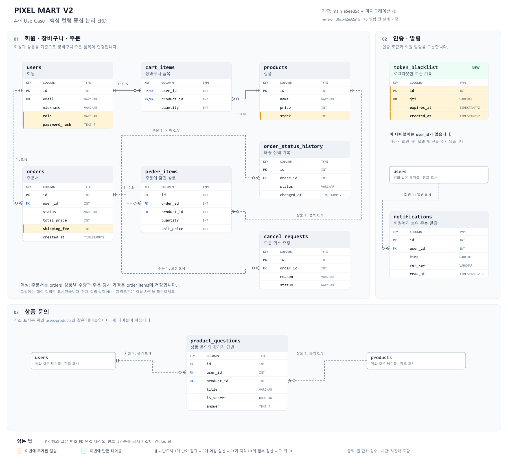

# PIXEL MART V2 — 회원·주문·문의 ERD

ERD는 **어떤 데이터를 저장하고, 데이터끼리 어떻게 연결되는지 보여 주는 지도**입니다. 이번 그림은 회원가입·주문·관리자 주문 처리·상품 문의에 필요한 10개 테이블을 다룹니다.

[확대해 보는 SVG 원본](diagrams/pixel-mart-day1-erd.svg) · [전체 컬럼 사전](ERD_COLUMNS.md)

## 그림을 읽는 순서

1. **표 제목**을 보세요. `users`는 회원, `orders`는 주문입니다. 표 안의 한 줄은 컬럼, 실제 저장된 한 건은 행이라고 부릅니다.
2. **PK**는 행을 구분하는 번호입니다. 회원 번호가 7이면 `users.id=7`입니다. 장바구니는 회원 번호와 상품 번호를 묶어서 한 행을 구분합니다.
3. **FK**는 다른 표의 번호를 가리킵니다. 주문의 `user_id=7`은 ‘7번 회원의 주문’이라는 뜻입니다. PK이면서 FK인 값은 `PK/FK`로 적었습니다.
4. **관계선 끝의 기호**를 보세요. `||`는 반드시 1개, 동그라미와 갈퀴는 0개 이상입니다. 회원 한 명은 주문이 없을 수도, 여러 개 있을 수도 있습니다. 선은 요청 처리 순서를 나타내는 화살표가 아닙니다.
5. **노란 행**은 이번에 추가한 컬럼, **초록 제목**은 이번에 만든 테이블입니다. `?`는 값이 없어도 된다는 표시입니다.

실선은 연결 값이 자식 표의 PK에도 포함된 경우입니다(장바구니의 회원·상품 번호). 점선은 그 외 FK 연결입니다. 테두리만 있는 `users`·`products`는 위와 **같은 테이블을 다시 표시한 것**이며 새 테이블이 아닙니다.

## 주문 한 건으로 이해하기

7번 회원이 키캡 2개와 장패드 1개를 주문한다고 생각해 보세요.

| 어디에 저장하나요? | 무엇을 저장하나요? |
|---|---|
| `users` | 주문한 회원의 정보 |
| `products` | 상품 이름, 현재 가격, 남은 재고 |
| `cart_items` | 주문 전에 회원이 담아 둔 상품과 수량 |
| `orders` | 주문 번호, 주문한 회원, 받는 사람, 주소, 총액 등 주문서 한 장 |
| `order_items` | 키캡 2개, 장패드 1개처럼 주문에 들어간 상품별 내역 |
| `order_status_history` | 준비 중·배송 중 등 상태가 바뀐 기록 |
| `cancel_requests` | 회원이 취소를 요청한 기록 |

주문서는 한 장이지만 주문 품목은 여러 줄이므로 `orders`와 `order_items`를 나눕니다. `unit_price`에는 **주문 당시 가격**을 저장합니다. 나중에 상품 가격이 바뀌어도 지난 주문 금액이 달라지지 않게 하기 위해서입니다.

그림의 0..N은 DB의 연결 제약 기준입니다. ‘새 주문에는 품목이 최소 1개 필요하다’는 업무 규칙은 주문 코드에서 추가로 검사합니다.

## 인증·문의·알림은 이렇게 연결됩니다

| 테이블 | 쉬운 설명 |
|---|---|
| `token_blacklist` | 로그아웃한 로그인 토큰의 식별값(`jti`)과 만료 시각을 보관합니다. 이 표에는 `user_id`가 없어서 회원 표와 FK 선을 잇지 않습니다. 실제 토큰 차단 코드는 인증 담당자가 연결합니다. |
| `product_questions` | 누가 어떤 상품에 문의했는지 저장합니다. 회원과 상품 양쪽에 연결됩니다. 답변 전에는 `answer`가 비어 있어도 됩니다. |
| `notifications` | 어느 회원에게 어떤 알림을 보냈는지 저장합니다. `ref_key`는 같은 알림을 두 번 보내지 않기 위한 값이며, 주문 번호를 가리키는 FK가 아닙니다. |

## 이번에 추가하는 데이터

| 위치 | 무엇을 위해 추가하나요? | 기존 데이터는 어떻게 되나요? |
|---|---|---|
| `users.role` | 일반 회원과 관리자 구분 | 기존 회원은 `user` |
| `users.password_hash` | 이메일 로그인용 비밀번호 해시 보관. 원문 비밀번호는 저장하지 않음 | 비어 있어도 됨(NULL) |
| `token_blacklist` | 로그아웃한 토큰 기록 | 새 테이블. `jti`는 중복 불가 |
| `products.stock` | 남은 재고 수량 | 기존 상품은 30 |
| `orders.shipping_fee` | 주문 당시 배송비 | 기존 주문은 0원 |

상품 재고를 실제로 줄이는 처리, 취소 승인 시 재고를 돌려주는 처리, 로그아웃 토큰을 막는 처리는 각 후속 기능에서 연결합니다. **컬럼이 생겼다고 기능까지 자동으로 완성되는 것은 아닙니다.**

## 기준과 생략 범위

- 기준: main `e5ee85c`에 #5의 마이그레이션 `d6cb42e32a1b`를 더한 구조입니다. [PR #45](https://github.com/KANT-2/pixel-mart-v2/pull/45)는 아직 병합 전입니다.
- 읽기 쉽게 핵심 컬럼만 그렸습니다. 모든 컬럼의 길이·NULL·제약조건은 [컬럼 사전](ERD_COLUMNS.md)에 있습니다.
- 상품 분류(`categories`)와 지역(`regions`) 등 이번 4개 기능의 중심이 아닌 표는 그림에서 생략했습니다. 실제 FK는 컬럼 사전에 남겼습니다.
- 이 문서를 다듬는 작업은 코드나 DB 구조를 바꾸지 않습니다.

## 관련 자료

- [기사 인수 상태와 변경 전 화면](BASELINE_DAY1.md)
- [팀 Notion — ERD 쉽게 보기](https://app.notion.com/p/teamsparta/ERD-4032dc3ef51480d3906ec0445bbd70c1)
- [기존 작업일지·인수 확인 기록](https://app.notion.com/p/teamsparta/1-ERD-4032dc3ef514800d8b72c2929c332a9b)
